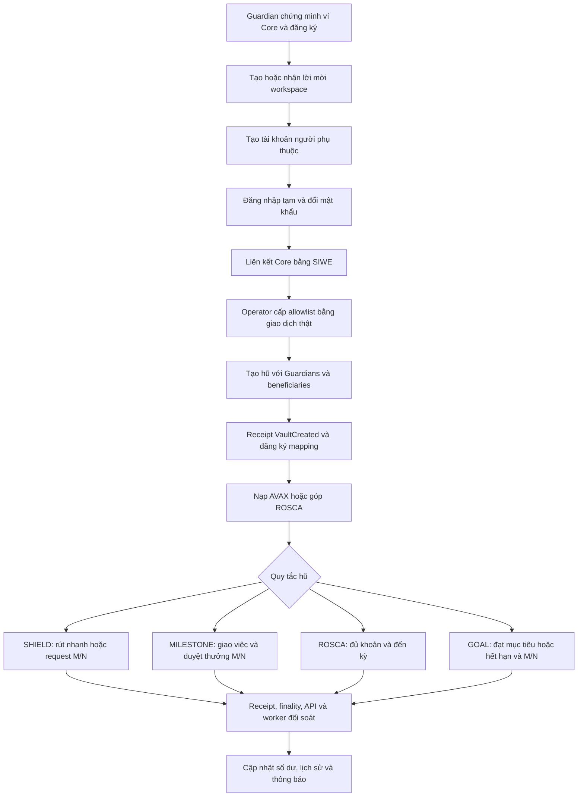
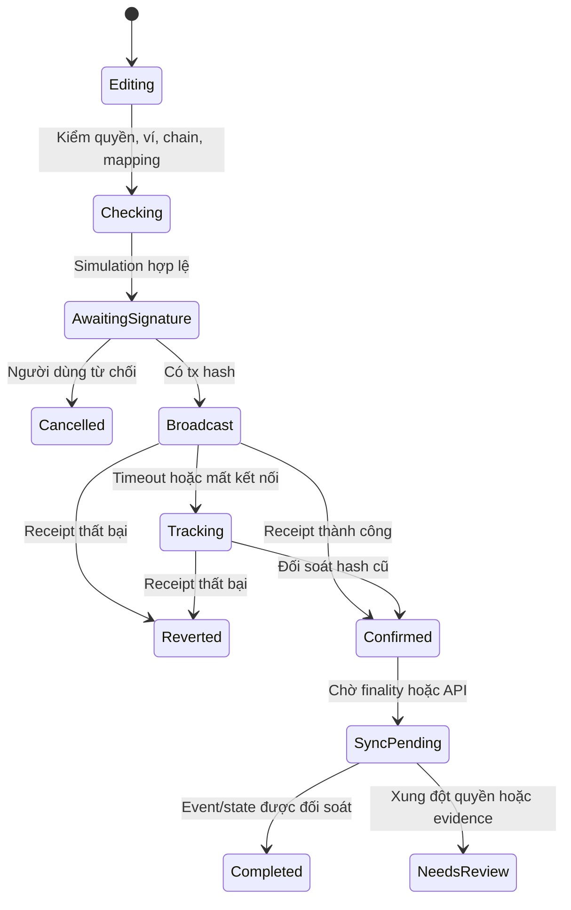

> **Historical engineering note.** This document may describe superseded plans or validation results. See the [current project status](../docs/STATUS.md) for supported behavior and deployment evidence.

# Kinetix — Workflow chức năng chính

Ngày đối chiếu: 05/11/2026. Phạm vi: working tree hiện tại, gồm nâng cấp T1 chưa deploy.
Tài liệu này mô tả hành vi trong mã và luồng cần hoàn thiện; không xác nhận đã chạy E2E Fuji.
Tình trạng bàn giao và việc còn chờ nghiệm thu: [rà soát ngày 06/11/2026](../docs/RECHECK_2026-11-06.md).

## 1. Phạm vi sản phẩm và trạng thái

T1 dùng AVAX trên Fuji chain 43113. Hub áp policy, Cashflow giữ tiền; mọi tài sản ở cùng chain.
Bridge, ERC20, real yield và tài trợ gas đang tắt. Người dùng trả phí Fuji bằng Core.
Luồng tài khoản hiện dùng username/password, cookie session và Core SIWE; không có đăng nhập PIN/passkey đang hoạt động.

`shared/deployment.json` hiện `enabled=false`, chưa có địa chỉ/receipt triển khai.
Hồ sơ lần trước ghi 116 test đạt, 15 DB integration pending; đây là kết quả đã ghi tại
[bàn giao T1](T1_HANDOVER.md), không phải lần chạy test mới của đợt lập workflow này.

| Lớp | Nguồn sự thật | Không được suy ra |
|---|---|---|
| Danh tính, phiên, membership, người quản lý | Backend + PostgreSQL | Kết nối ví không tự tạo phiên/quyền |
| Quyền tài chính theo hũ | Contract, địa chỉ signer, membership epoch | ADMIN ứng dụng không mặc nhiên là Guardian on-chain |
| Tiền, khoản chi, phiếu duyệt | Ledger và event/receipt contract | Không ghi nhận chi từ nút bấm, số phiếu DB hoặc response ví |
| Deployment | Manifest + đối soát RPC/code/receipt/wiring | Có địa chỉ chưa có nghĩa đã verified hoặc enabled |
| Số dư/lịch sử hiển thị | Projection từ chain có nguồn và thời điểm đồng bộ | Cache hoặc dữ liệu seed không phải bằng chứng tài sản |

## 2. Vai trò và quyền

| Vai trò | Quyền ứng dụng | Quyền contract |
|---|---|---|
| ADMIN workspace | Quản lý workspace; cấp quyền quản lý; xem dữ liệu theo policy | Chỉ được ký duyệt nếu là Guardian của hũ; chỉ rút nếu là beneficiary |
| GUARDIAN workspace | Tham gia quản trị; quản lý người phụ thuộc khi được cấp quyền | Phải có tên trong Guardians của đúng hũ |
| Người già | Xem hũ/lịch sử cá nhân; dùng SHIELD nếu được gán | Ví cá nhân phải được allowlist và là beneficiary |
| Trẻ nhỏ | Xem việc của mình, gửi minh chứng, nhận thưởng | MILESTONE chỉ chi theo assignee và quorum; chưa có thuộc tính tuổi on-chain |
| Người quản lý thành viên | Cấp tài khoản tạm, reset, khóa truy cập trong phạm vi được giao | Không tự có quyền giữ tiền hoặc thay ví thành viên |
| `familyAdmin` của Hub | Operator on-chain, có thể khác ADMIN workspace | Cấp/thu allowlist toàn Hub, pause; không có phiếu Guardian bổ sung |
| Owner Cashflow | Vận hành kho tiền | Pause/unpause; không có đường rút bỏ qua Hub |

Nút xem trước giao diện người già/trẻ nhỏ chỉ đổi cách trình bày. Nó không đổi user, ví hoặc quyền.
Allowlist hiện là toàn Hub; khóa membership ứng dụng trong một workspace không tự thu quyền gọi contract.

## 3. Hành trình tổng thể

Đây là thứ tự phụ thuộc. Tài khoản đã READY vẫn có thể chưa được giao dịch nếu thiếu allowlist,
role hũ, mapping verified hoặc deployment enabled.

## 4. WF-01 — Đăng ký và đăng nhập Guardian

1. Kết nối Core; lấy challenge mục đích REGISTER hoặc LOGIN từ backend.
2. Ký SIWE có domain, chain, nonce, thời hạn và mục đích cụ thể.
3. Backend xác minh, tiêu thụ challenge một lần và kiểm địa chỉ/tài khoản.
4. Đăng ký mới tạo credential, user, workspace/membership và provisioning request trong DB transaction.
5. Cấp cookie phiên. Lần sau có thể đăng nhập bằng username/password; ví chỉ cần khi giao dịch hoặc reauth.

API chính: `/api/auth/wallet/challenge`, `/register-family`, `/verify-siwe`, `/login`, `/me`.
Không cấp Guardian bằng mã gia đình công khai hoặc form tự chọn role.
Trường hợp lỗi: nonce đã dùng, sai domain/chain, ví thuộc tài khoản khác, tài khoản đình chỉ, credential không hợp lệ.

**Đích hoàn tất:** có phiên hợp lệ và membership; quyền allowlist tài chính vẫn là một bước riêng.

## 5. WF-02 — Tạo và kích hoạt tài khoản người phụ thuộc

1. Người được phân công quản lý chọn workspace, tạo ELDERLY/CHILD với idempotency key.
2. Backend tạo user, credential tạm, membership và quan hệ quản lý nguyên tử; trả credential bàn giao một lần.
3. Thành viên đăng nhập tạm, đặt mật khẩu riêng; server xoay phiên/thu hồi credential cũ theo policy.
4. Thành viên dùng Core của chính mình ký challenge LINK; backend kiểm chữ ký và uniqueness địa chỉ.
5. Backend lưu liên kết ví, ghi audit và tạo yêu cầu cấp quyền on-chain.
6. Thành viên vào dashboard đúng membership, nhưng thao tác tài chính phải qua WF-04.

Trạng thái hiện tại: `SET_PASSWORD / CHANGE_PASSWORD → LINK_WALLET → READY`.
READY là trạng thái tài khoản, không phải chứng nhận mọi quyền on-chain đã sẵn sàng.
Không yêu cầu seed phrase/private key; Kinetix không tự sinh ví thay người dùng.

Nguồn: `backend/src/auth/service.ts`, `authRoutes.ts`, trang `/activate` và `useAuth.ts`.

## 6. WF-03 — Workspace, lời mời, phiên và quản lý thành viên

| Hành động | Workflow và điều kiện |
|---|---|
| Tạo workspace | Guardian có quyền → tạo workspace DB → dùng deployment từ manifest → chưa tự tạo hũ |
| Mời Guardian | ADMIN tạo invitation gắn ví → đúng tài khoản/ví chấp nhận → membership → cấp quyền on-chain riêng |
| Chuyển workspace | Kiểm membership → xóa cache phạm vi cũ → nạp lại dữ liệu/quyền → kiểm lại scope trước ký |
| Phân công quản lý | ADMIN chọn Guardian hợp lệ → cập nhật quan hệ quản lý → audit |
| Sửa hồ sơ | Người quản lý hợp lệ sửa thông tin cho phép; không sửa ví bằng profile API |
| Reset mật khẩu | Manager được phân công reauth → credential tạm mới → thu hồi phiên cũ → người dùng đổi mật khẩu; ví giữ nguyên |
| Khóa truy cập | Khóa membership theo workspace; thông báo riêng rằng quyền contract chưa tự bị thu hồi |
| Đăng xuất/thu hồi phiên | Thu hồi session backend và cache user; disconnect ví không tự xóa liên kết địa chỉ |

Nguồn: `membership`, `managedAccess`, `updateManagedMember`, `createInvitation`, `acceptInvitation`, `/auth/sessions`.
Thêm người vào workspace hiện không thêm người đó vào Guardians/beneficiaries của hũ đã tạo.

## 7. WF-04 — Cấp quyền on-chain

1. Backend tạo provisioning request cho user/workspace/deployment/chain đúng.
2. Operator thực sự có quyền `familyAdmin` kiểm yêu cầu và gọi `setAllowlistStatus(wallet,true)`.
3. Chờ receipt, kiểm event `AllowlistStatusChanged` và trạng thái live `isAllowlisted`.
4. Nếu mạng đích có transaction allowlist precompile, kiểm thêm quyền mạng; Fuji T1 không được giả lập Family L1.
5. Đánh dấu request CONFIRMED theo evidence; role Guardian/beneficiary vẫn được kiểm riêng theo hũ.

UI hiện tại chủ yếu nhận hash receipt do operator cung cấp ở `ProvisioningConfirm`.
Cần hoàn thiện màn hình operator và đồng bộ chain từ manifest; hiện `auth/service.ts` còn ba nhánh fallback `99999`.

**Đích hoàn tất:** đúng ví, deployment và chain được cấp quyền; không dùng cột boolean DB làm quyền tài chính.

## 8. WF-05 — Tạo hũ và xác minh mapping

1. Guardian chọn SHIELD/MILESTONE/ROSCA/SHARED_GOAL, tên, các ví và ngưỡng M/N.
2. Kiểm thành viên đã liên kết và được allowlist; mọi tiền nhập dưới dạng chuỗi, parse sang wei.
3. T1 bắt buộc `bufferRatioBps=10000`. SHIELD có hạn mức; các loại còn lại không dùng fast limit.
4. Kiểm goal/deadline hoặc period/contribution theo loại; Guardians duy nhất, threshold đạt được.
5. Core ký `createCustomVault` hoặc `createAdvancedVault`; chờ receipt/finality.
6. POST `/api/vaults` bằng tx hash. Backend kiểm creator thực, event đúng Hub và state `getVault`.
7. Lưu `(chain,hub,vaultId)` và `(creationTx,logIndex)` duy nhất; liên kết membership ứng dụng hợp lệ.

Trạng thái nghiệp vụ mong muốn: `DRAFT → ONCHAIN_CREATED → REGISTRATION_PENDING → VERIFIED`.
Hiện chưa có operation record bền vững bao phủ đầy đủ các trạng thái này.
Sai mạng/Hub/evidence phải giữ hũ chưa đối soát; không sửa ID/hub hàng loạt để vượt lỗi 409.

Lưu ý cấu hình: assignee của MILESTONE không được là Guardian của chính hũ; cần cảnh báo ngay lúc chọn thành viên.
T1 chưa có hàm thêm/xóa thành viên hay đổi quorum/hạn mức hũ đang hoạt động; recovery không được dùng thay chức năng thêm thành viên.

## 9. WF-06 — Máy trạng thái giao dịch dùng chung

Các tên trên là mô hình đích thống nhất, không phải toàn bộ enum đã có trong mã.
Hiện trạng: hook có `idle/signing/success/tracking/error`; queue có chain status và sync status riêng.

Trước ký: session READY → membership → deployment → mapping/resource → đúng Core account → đúng chain
→ allowlist → policy/recipient/amount → simulation → kiểm lại session/account/workspace sau các prompt.

Sau hash: lưu chain/hash và thao tác đồng bộ; dù disconnect vẫn theo dõi receipt. API kiểm event độc lập,
không tin amount/status do frontend gửi. Chỉ completed sau xác nhận chain và đối soát cần thiết.

**Khoảng trống cần sửa:** `syncRecord` hiện phân loại phần lớn HTTP 4xx thành BLOCKED; `409 RECEIPT_NOT_FINALIZED`
có thể bị dừng retry dù chỉ đang chờ finality. Queue đang ở memory/localStorage, giới hạn 30 bản ghi/7 ngày;
chưa đủ để phục hồi độc lập khi mất thiết bị, tx replaced/dropped hoặc mất storage.

## 10. WF-07 — Nạp AVAX

1. Chọn hũ đã verified; ROSCA đi qua workflow góp kỳ riêng.
2. Nhập số tiền chính xác → WF-06 → `depositToVault(vaultId)` kèm đúng `msg.value`.
3. Hub kiểm hũ tồn tại/active/allowlist; ghi toàn bộ AVAX cục bộ, chuyển vào Cashflow khi đã wiring.
4. Receipt `FundsDeposited` là evidence, backend đọc lại overview, worker lập lịch sử/thông báo theo actor.
5. Số dư mới hiển thị với thời điểm/block đồng bộ; lỗi API sau receipt không làm giao dịch nạp thành thất bại.

Invariant: tiền tăng bằng tài sản thực nhận; `cChainPrincipal=0`; nạp không tự tạo hũ.
Chuyển AVAX thẳng vào địa chỉ contract là surplus, không tự được ghi nhận vào một hũ.

## 11. WF-08 — SHIELD: rút nhanh và request M/N

**Rút nhanh:** beneficiary chọn số tiền → API đọc policy thật → kiểm hạn mức mỗi lần và ngày
→ `fastWithdraw` → một điểm chi tiền tại Fuji → receipt `FastWithdrawalExecuted` → sync.

Hạn mức ngày hiện tính **chung toàn hũ**, theo `block.timestamp / 1 days`, bằng 2 × fast limit.
Nhiều beneficiaries dùng chung ngân sách đó; chưa có hạn mức riêng từng người hoặc cửa sổ 24 giờ trượt.
Không sửa hạn mức bằng một Guardian sau khi tạo hũ.

**Rút qua quorum:** beneficiary tạo `requestLargeWithdrawal` → `WithdrawalRequested` → lưu request
→ Guardians đúng hũ ký `approveWithdrawal` → đủ M/N và còn khả dụng thì giao dịch cuối chi tiền.
Request hết hạn 48 giờ; duyệt lặp, thực thi lặp và epoch cũ bị chặn.
Có đường chữ ký off-chain `executeWithdrawalWithSignatures`, cần đồng bộ UI/typed data và kiểm replay.

Không mặc định giữ chỗ vốn cho mọi withdrawal request: các request có thể cạnh tranh cùng số dư.
UI phải cảnh báo nếu thanh khoản thay đổi trước chữ ký cuối; quorum đạt trong DB không chứng minh đã chi.
Hiện chưa có workflow contract để requester hủy hoặc Guardians ghi từ chối request; không biến nhãn UI thành chức năng đã có.

## 12. WF-09 — MILESTONE: giao việc, minh chứng, duyệt thưởng và hủy

1. Guardian chọn hũ MILESTONE, assignee beneficiary không phải Guardian của hũ, số thưởng và mô tả.
2. `createChore` giữ chỗ vốn ngay: khả dụng = tổng quỹ − tổng thưởng đang giữ chỗ.
3. API đối soát `ChoreCreated` rồi tạo chore gắn đúng user/vault.
4. Assignee tải ảnh qua API có xác thực; server kiểm ảnh, chuẩn hóa PNG, kiểm quyền và thời hạn.
5. Assignee ký `claimChoreCompleted`; backend xác minh `ChoreClaimed` và gắn attachment hợp lệ.
6. Mỗi Guardian ký `verifyAndRewardChore`; event `ChoreApproved` tăng tiến độ. Chỉ đủ quorum mới có `ChoreRewarded` và tiền về ví.
7. Guardian hủy nhiệm vụ chưa chi bằng `cancelChore`: giải phóng reservation đúng một lần, không chuyển thưởng.

Trạng thái: `TODO → SUBMITTED → đủ M/N → REWARDED`; nhánh chưa chi có thể `CANCELLED`.
Contract có hủy; worker và enum nhận CANCELLED, nhưng transaction-context/sync whitelist/UI chưa khép kín đường hủy.
Chưa có đường trả bài để sửa và nộp lại trên contract; phải thiết kế trước khi quảng bá chức năng này.
Không ghi ảnh/nội dung riêng tư của trẻ lên chain; tên việc/địa chỉ/số tiền on-chain là công khai.

## 13. WF-10 — ROSCA: góp và nhận quỹ

1. Tạo hũ với danh sách/thứ tự beneficiaries, khoản góp và thời lượng kỳ cố định.
2. Thành viên đọc round ID, số tiền phải góp, trạng thái đã góp và thời điểm đủ điều kiện.
3. Ký `contributeRoscaRound` đúng số tiền, mỗi thành viên một lần/kỳ; không dùng `depositToVault`.
4. Khi đủ tất cả khoản và đến hạn, một địa chỉ được allowlist có thể gọi `payoutRoscaRound`.
5. Recipient được contract lấy từ thứ tự vòng, không lấy từ người bấm nút hoặc payload tùy ý.
6. Chi đúng tổng khoản của kỳ → `RoscaRoundPaid` → tăng round → đồng bộ số dư/lịch sử.
7. Kết thúc sau một chu kỳ bằng số beneficiaries; không tự mở chu kỳ mới.

Hiện kỳ thiếu khoản chờ vô thời hạn; chưa có default deadline, hủy/hoàn tiền, rời nhóm hoặc xử lý nợ.
Đây là quyết định sản phẩm cần chốt trước khi mở ROSCA rộng rãi. Giao diện cũng phải giải quyết việc member
không phải ADMIN/GUARDIAN hiện bị dashboard chuyển về portal riêng, chưa có đường ROSCA tương đương.

## 14. WF-11 — SHARED_GOAL

1. Tạo target/deadline, beneficiaries và quorum; người được phép góp AVAX vào hũ.
2. UI trình bày số đã góp, target, deadline từ dữ liệu có evidence.
3. Khi balance đạt target **hoặc** qua deadline, beneficiary được tạo request quyết toán.
4. Guardians duyệt M/N; contract kiểm lại điều kiện ở lúc thực thi, chi về ví requester.

Hiện chưa có recipient nhà cung cấp, hoàn tiền theo người góp, contributor ownership hoặc goal cancellation.
Nếu rút một phần khiến balance thấp hơn target trước deadline, request tiếp theo có thể bị khóa lại.
Cần chốt goal mở khóa một lần hay kiểm target mỗi lần; không tự thay semantics của hũ đang có vốn.

## 15. WF-12 — Quên mật khẩu, đổi ví và mất ví

| Tình huống | Workflow |
|---|---|
| Quên mật khẩu, còn ví | Manager reset theo WF-03; địa chỉ và tài sản giữ nguyên |
| Còn ví cũ, muốn đổi ví | Đề xuất: reauth + chứng minh ví cũ/mới → duyệt thay đổi → xử lý toàn bộ hũ liên quan → chuyển liên kết ứng dụng sau đối soát |
| Mất ví cũ | Guardians của từng hũ duyệt `recoverMemberWallet` → arrays/mappings và recipients được chuyển → epoch mới → invalidation request/phiếu cũ |
| Sau recovery | Phải đối soát tất cả workspace/hũ, cập nhật liên kết ví, phiên và provisioning bằng bằng chứng; không sửa DB trực tiếp để thay thế recovery |

Contract đã có recovery theo hũ. API liên kết ví hiện chỉ cho liên kết lần đầu và chặn ghi đè;
chưa có quy trình điều phối recovery contract ↔ userWallets ↔ membership/phiên hoàn chỉnh.
Vì vậy hiện không coi mất ví là workflow đã hoàn tất sản phẩm. Chỉ reset mật khẩu không khôi phục khóa ví.

## 16. WF-13 — Lịch sử, thông báo và đối soát

1. API nhận receipt hợp lệ hoặc worker đọc log finalized của deployment/hũ verified.
2. Dùng khóa chain/tx/log để chống ghi trùng; actor/recipient chỉ gắn với tài khoản có quan hệ hợp lệ.
3. Chi tiền chỉ lập trạng thái paid từ event thực chi; `ChoreApproved` không phải `ChoreRewarded`.
4. Worker checkpoint sau xử lý; snapshot cập nhật số dư, request, round và task.
5. Người dùng xem lịch sử cá nhân; người có quyền xem thêm phạm vi quản trị; ảnh minh chứng kiểm quyền riêng.
6. Lỗi indexer/DB → báo đang đồng bộ, giữ hash và retry đối soát; không tự gửi lại giao dịch.

Hiện worker có cursor theo hũ và chống event trùng, nhưng request/chore snapshot chủ yếu cập nhật
các record đã có trong DB. Cần bổ sung backfill tài nguyên bị mất nếu API đăng ký thất bại và queue client mất.
Không tự tạo user/membership khi thấy ví trong event. Read-model phải nêu block/checkedAt và trạng thái stale.

## 17. WF-14 — Deployment, vận hành và khôi phục sự cố

Thứ tự chuẩn: kiểm thử/migration cô lập → build artifact/ABI → deploy candidate Fuji → lưu journal/receipt
→ wiring → verified finalized → kích hoạt manifest → rebuild UI/restart API-worker → tạo mapping thật → E2E.

Hũ cũ được kiểm kê theo deployment, policy, quyền, tài sản và evidence. Không xóa hũ có vốn hoặc đổi mapping
để làm sạch giao diện. Contract hiện không giả định proxy-upgrade; thay source có thể cần deploy version mới.

Sự cố: dừng mở giao dịch mới/pause bằng đúng authority → giữ receipt/journal → đối soát các tx đã broadcast
→ replay worker theo cursor có kiểm soát → kiểm invariant tài sản rồi mới mở lại. Đổi config không đảo ngược tx.

**Điều kiện gọi là hoàn tất chức năng:** happy path, lỗi/quyền âm, retry/replay, dữ liệu đồng bộ
và bằng chứng E2E trên môi trường đích. Test cục bộ hoặc mã có hàm tương ứng chưa đủ.

## 18. Nguồn mã để triển khai tiếp

| Nhóm | Vị trí |
|---|---|
| Account, SIWE, sessions, quản lý | `backend/src/auth/service.ts`, `backend/src/routes/authRoutes.ts`, `frontend/src/hooks/useAuth.ts` |
| App access và provisioning | `backend/src/services/workspaceAccess.ts`, `backend/src/routes/apiRoutes.ts`, `frontend/src/components/auth/ProvisioningConfirm.tsx` |
| Policy và giữ tiền | `contracts/FamilyHub.sol`, `contracts/VaultCashflow.sol` |
| Receipt và deployment | `backend/src/services/chainService.ts`, `deploymentService.ts`, `shared/deploymentManifest.ts`, `shared/vaultMapping.ts` |
| Giao dịch phía client | `frontend/src/lib/web3/client.ts`, `frontend/src/hooks/useMemberTransaction.ts`, `frontend/src/context/FamilyContext.tsx` |
| Portal và UX quản trị | `frontend/src/app/dashboard/page.tsx`, `components/member/`, `components/vaults/`, `components/views/` |
| Minh chứng, lịch sử, worker | `backend/src/routes/memberRoutes.ts`, `services/activityService.ts`, `workers/eventListener.ts` |
| Triển khai và DB | `scripts/deploy.ts`, `scripts/check-testnet.ts`, `backend/drizzle/`, `shared/deployment.json` |
