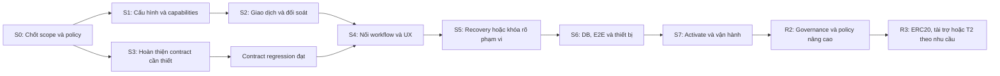

# Kinetix — Kế hoạch nâng cấp và chỉnh sửa V2

Ngày lập: 05/11/2026. Phạm vi: toàn bộ chức năng chính Web2 + Web3 của Kinetix.
Trạng thái: **kế hoạch sau đối chiếu mã; chưa thực hiện các hạng mục mới trong tài liệu này**.
Workflow chuẩn: [KINETIX_FUNCTIONAL_WORKFLOWS.md](KINETIX_FUNCTIONAL_WORKFLOWS.md).

## 1. Mục tiêu và cách chia bản phát hành

Ưu tiên tiếp theo là hoàn thiện T1 từ tài khoản đến chi tiền và đối soát, sau đó mới mở thêm tài sản,
tài trợ phí hoặc kiến trúc hai chain. Giữ lựa chọn T1 Fuji của người dùng ở phiên trước.

| Mốc | Phạm vi | Điều kiện được công bố |
|---|---|---|
| R0 — Khép kín kỹ thuật | Cấu hình, quyền, transaction lifecycle, DB/worker nhất quán | Có regression và integration cô lập; chưa mặc định là testnet đã chạy |
| R1 — T1 sử dụng được | Account/workspace/provisioning, 4 policy có workflow tương ứng hoặc bị tắt rõ ràng, recovery có phạm vi công bố | Receipt Fuji thật + API/DB/indexer + Core desktop/mobile; không có blocker trong chức năng được mở |
| R2 — Quản trị và policy mở rộng | Thêm/xóa thành viên hũ, policy updates có quorum, refund/default/goal settlement nâng cao | Đặc tả đã chốt, contract được review, migration và E2E riêng |
| R3 — Tài trợ/ERC20/T2 | Các feature độc lập, chỉ chọn khi có nhu cầu và hạ tầng | Mỗi feature có cổng enable riêng; bridge phải có tài sản thực và đối soát hai mạng |

Không gọi R1 hoàn tất nếu một đường UI còn dẫn tới chức năng không có API/contract hoặc chỉ có happy path local.
Nếu chưa hoàn thiện một feature, khóa cả điểm vào tạo nghĩa vụ mới và hành động liên quan; UI ẩn đơn thuần không đủ.
Không khóa đường giải quyết nghĩa vụ/tài sản đã tồn tại mà chưa có phương án phục hồi.

## 2. Baseline đã biết

- Manifest công khai: version `2.0.0-t1`, chain 43113, `enabled=false`, chưa có deployment addresses/receipts.
- Hồ sơ trước ghi 116 test đạt, 15 DB integration pending; compile/typecheck/build đạt, Solhint 0 lỗi/351 cảnh báo.
- Deploy lần trước dừng `HH108` trước broadcast. Phiên lập plan này không thử deploy, không đọc DB sản xuất,
  không gửi giao dịch và không chạy lại bộ test; không suy ra RPC hiện nay vẫn lỗi từ kết quả cũ.
- Contract đã có hardening T1 và các feature chưa đủ điều kiện đang tắt; không cần viết lại toàn bộ nền tảng.
- Vẫn có khoảng trống tích hợp và UX được chỉ ra dưới đây. Mã đã có không đồng nghĩa chức năng đã nghiệm thu.

## 3. Các vấn đề cần xử lý sau khi đọc mã

Các finding dưới đây là quan sát tĩnh trong working tree, chưa phải báo cáo khai thác hay kết quả E2E mới.
P0 là chặn mở giao dịch/triển khai trong phạm vi tương ứng; không mặc định tất cả đều là lỗ hổng mất tiền.

| ID | Ưu tiên | Hiện trạng/bằng chứng mã | Tác động và hướng sửa |
|---|---|---|---|
| GAP-01 | P0 | `auth/service.ts`: tạo provisioning trong link/register/invitation còn fallback chain `99999`; SIWE allowed chains còn cấu hình Family L1 | Thành viên có thể READY nhưng provisioning sai mạng. Dùng deployment service xuyên suốt; tách policy chain đăng nhập khỏi chain giao dịch |
| GAP-02 | P0 | `client.ts::syncRecord` đặt phần lớn 4xx thành BLOCKED, trong khi `verifiedEvent` trả 409 khi chưa finalized | Receipt thành công có thể không tự retry sync. Phân loại bằng error code/retryability, không chỉ HTTP status |
| GAP-03 | P0 | `workspaceAccess.ts`: ADMIN được `canApprove=true`; CREATOR có thể được tính là reviewer dù không là Guardian on-chain | UI/API cho phép hành động contract sẽ từ chối. Tính capabilities từ giao của quyền app và quyền hũ live |
| GAP-04 | P1 | Pending queue chỉ ở memory/localStorage, tối đa 30 record/7 ngày; thiếu operation ID/deployment/workspace/nonce đầy đủ | Mất thiết bị/storage hoặc tx replaced/dropped khó phục hồi. Operation journal server và endpoint reconcile theo scope |
| GAP-05 | P1 | Worker cập nhật request/chore đã tồn tại trong DB; chưa khép kín khám phá tài nguyên mất sau receipt/API failure | On-chain có tài nguyên nhưng UI không có record. Backfill event của hũ đã verified, không tự tạo user/membership |
| GAP-06 | P1 | Contract có `cancelChore`; transaction-context, sync path và UI chưa có đường hủy tương ứng | Reservation có đường giải phóng on-chain nhưng người dùng không dùng được trọn luồng |
| GAP-07 | P1 | Contract có `taskApprovalCount/taskApprovals` theo epoch; UI chưa đọc đủ tiến độ thưởng này | Khó biết còn thiếu chữ ký, có thể bấm lại signer đã duyệt. Trả capabilities và tiến độ thưởng thật |
| GAP-08 | P1 | SHARED_GOAL tạo/nạp được; chưa có màn chi tiết/request quyết toán chuyên biệt được nối như SHIELD | Có thể tạo hũ có vốn nhưng thiếu đường giải quyết trong app. Nối đủ trước mở tạo goal |
| GAP-09 | P1 | ROSCA chỉ nằm ở route quản trị; member thường bị dashboard redirect về portal riêng | Beneficiary hợp lệ trên chain chưa có đường góp/xem vòng trong app. Điều hướng theo capability, không chỉ role |
| GAP-10 | P0 cho recovery | `recoverMemberWallet` có ở contract; `/wallet/link` chặn ghi đè; chưa có coordinator thay ví app | Recovery một hũ không đồng bộ tài khoản và các hũ khác. Thiết kế workflow nhiều bước có evidence và trạng thái partial |
| GAP-11 | Quyết định policy | SHIELD daily limit là chung toàn hũ = 2 × fast limit, không phải riêng mỗi người | Cần công bố đúng và chọn semantics trước khi thay contract |
| GAP-12 | P0 trước mở rộng ROSCA | ROSCA chưa có default/cancel/refund/exit; kỳ thiếu khoản chờ không giới hạn | Rủi ro vốn bị treo theo policy. Chốt cơ chế hoặc chỉ mở thử nghiệm có điều kiện rõ ràng |
| GAP-13 | Quyết định policy | Goal kiểm balance >= target ở mỗi lần thực thi; chi một phần có thể khóa phần còn lại tới deadline | Chọn unlock một lần hay target mỗi lần; không gọi đây là lỗi cần bỏ guard trước khi chốt policy |
| GAP-14 | P1 | Chưa có quản trị thêm/xóa member, đổi quorum/hạn mức hũ đã tạo; allowlist/pause toàn Hub | Thêm thành viên workspace không cập nhật hũ. R1 phải công bố giới hạn; R2 có governance/versioning riêng |
| GAP-15 | P1 | Snapshot worker đọc latest trong khi lịch sử lấy finalized; read-model thiếu provenance đầy đủ | Có thể hiển thị các ảnh chụp khác block. Pin block, lưu checkedAt/block/hash và trạng thái stale |
| GAP-16 | P1 | Manifest được script deploy kích hoạt sau wiring, frontend cần rebuild; chưa có activation workflow tách biệt | Có cửa sổ cấu hình lệch giữa server/UI và finality. Deploy candidate → verify → activation có kiểm tra version |
| GAP-17 | P2 | `useFamilyHub`, `FamilyContext`, `useMemberTransaction` còn các đường write song song; một số API dùng tuple index/`any` | Dễ lệch amount, errors, capabilities và trạng thái. Hợp nhất transaction layer và typed adapters |
| GAP-18 | P2 | Một số schema/i18n còn từ PIN/passkey/L1; 351 lint warnings theo lần kiểm trước | Dễ tạo cam kết sản phẩm sai. Kiểm nơi đang render; gỡ nội dung cũ có kế hoạch, không xóa dữ liệu legacy tùy tiện |

## 4. Các quyết định sản phẩm phải chốt trước phần sửa liên quan

Đây là đề xuất để lập backlog, chưa phải thay đổi policy đã được người dùng phê duyệt.

| ID | Quyết định | Đề xuất khởi đầu và hệ quả |
|---|---|---|
| DEC-01 | Tài sản/mạng R1 | Giữ AVAX/Fuji; mọi số tiền ký dùng chuỗi/bigint; không thêm USDC vào cùng hạn mức AVAX |
| DEC-02 | Quyền quản trị | Tách operator toàn Hub, ADMIN workspace, Guardian hũ và manager. Không suy quyền tài chính từ ADMIN/CREATOR |
| DEC-03 | Daily spending | R1 giữ ngân sách chung toàn hũ như contract và diễn giải rõ. Hạn mức theo người cần thiết kế/quorum/version mới |
| DEC-04 | Withdrawal requests | R1 có thể giữ không reserve vốn request, nhưng cảnh báo cạnh tranh và lỗi thanh khoản. Cancel/reject thật cần contract/event; trạng thái stale/expired không gán thành bị từ chối bởi Guardian |
| DEC-05 | Chore | Giữ thưởng M/N; hủy hiện do một Guardian và chỉ giải phóng vốn. Quy định hủy sau khi đã có phiếu, trả bài/nộp lại và deadline trước khi mở thêm |
| DEC-06 | Goal settlement | R1 có thể giữ semantics hiện tại và công bố rõ. Đề xuất đánh giá unlock một lần hoặc full settlement cho version mới; contributor refund phải có ownership ledger |
| DEC-07 | ROSCA | Nếu không xây default/refund trong R1, chỉ bật pilot có thời hạn/phạm vi và chấp nhận policy được ghi nhận; còn lại khóa tạo mới. Không hứa hoàn tiền tự động |
| DEC-08 | Recovery | Chứng minh ví mới, quorum từng hũ, điều phối mọi scope liên quan và DB commit sau evidence; không reset mật khẩu để thay ví |
| DEC-09 | Mobile/auth | R1 dùng tài khoản/password + Core; kết nối mobile cần provider/SDK thật, HTTPS và kiểm thiết bị. Không quảng bá PIN/passkey/gasless hiện chưa có |
| DEC-10 | Thành viên hũ | R1 khóa cấu hình sau tạo, ngoài recovery; nếu cần thêm/xóa hoặc đổi policy phải làm R2 trước khi mở lời hứa đó trên UI |

Mỗi quyết định lưu người chốt, ngày, version áp dụng và cách xử lý hũ cũ. Không đổi hồi tố policy hũ có vốn.

## 5. Trình tự triển khai lại

Contract/API correctness đi trước UI của chức năng liên quan. Không triển khai giao diện gửi write mới
khi contract cần thay đổi còn chưa qua regression. DB thật chỉ được migrate sau kiểm chứng cô lập.

### S0 — Đóng scope và chuẩn bị môi trường

- [ ] Lập danh sách feature mở trong R1: account, member management, provisioning, tạo/nạp hũ, SHIELD, MILESTONE; quyết định cụ thể goal/ROSCA/recovery.
- [ ] Chốt DEC-01…10, mô hình tin cậy và những giới hạn người dùng phải thấy trước khi ký.
- [ ] Chuẩn bị RPC Fuji có thể truy cập, DB test cô lập, staging HTTPS và các Core account thực có quyền tương ứng.
- [ ] Kiểm kê deployment cũ/hũ/role/evidence/tài sản bằng công cụ chỉ đọc; phân loại seed, chưa rõ và đã có vốn.
- [ ] Chọn version ứng viên và kế hoạch migration; bảo toàn working tree hiện tại, không triển khai lại từ đầu.

**Nghiệm thu:** có scope sheet và policy record; xác định đúng môi trường/ký/ngân sách; không trộn DB test với DB ứng dụng.

### S1 — Cấu hình thống nhất và quyền có thể giải thích

- [ ] CFG-01: sửa ba nhánh provisioning còn `99999`; đồng bộ auth chain policy với manifest T1 mà không phá challenge đang dùng.
- [ ] CFG-02: provisioning phải gắn deployment/Hub, không chỉ chain. Đối soát request cũ, không tự xác nhận hoặc gán hàng loạt.
- [ ] AUTHZ-01: capabilities trả `canCreate/canDeposit/canRequest/canApprove/canClaim/canCancel/canContribute/canPayout`, kèm reason code.
- [ ] AUTHZ-02: mỗi capability là giao của session/membership, quyền app, wallet linked, allowlist và role on-chain đúng hũ/epoch.
- [ ] AUTHZ-03: operator screen phân biệt người xem và người được ký; hỗ trợ gửi hoặc nhập receipt provisioning thật.
- [ ] AUTHZ-04: UI phân biệt account READY, ví connected, provisioned và financial-ready; khóa app không được ghi thành đã thu quyền on-chain.

Vị trí: `auth/service.ts`, `auth/security.ts`, `workspaceAccess.ts`, `transaction-context`, deployment service, provisioning/account UI.

**Nghiệm thu:** ADMIN không là Guardian không thấy nút ký; CREATOR không tự thành reviewer;
request provisioning mới trên T1 đều chain 43113/đúng Hub; không workspace nào được cấp quyền chéo.

### S2 — Giao dịch, retry và nguồn dữ liệu bền vững

- [ ] TX-01: thống nhất state machine WF-06; tách chain status, sync status và business status.
- [ ] TX-02: lỗi trả `code`, `retryable`, `retryAfter` khi cần. Finality pending/429/RPC tạm lỗi được retry theo hash cũ; auth/mapping conflict chuyển review.
- [ ] TX-03: operation record server có user/workspace/deployment/chain/Hub/resource/function, exact asset/amount/recipient, nonce/hash và trạng thái.
- [ ] TX-04: idempotency key và unique receipt/log; nếu mất response sau broadcast có thể tra lại; không nhận payload client làm bằng chứng tài chính.
- [ ] TX-05: theo dõi replaced/cancelled/dropped/unknown, đổi account, disconnect, đa tab, refresh và thiết bị khác; unknown không tự resend.
- [ ] IDX-01: indexer backfill request/chore của hũ đã verified từ finalized events. Actor chưa gắn được tài khoản → review, không tự tạo user/membership.
- [ ] IDX-02: cursor/checkpoint và ghi event/projection có semantics chống trùng/race; thử chạy hai worker, crash/restart và tài nguyên đăng ký muộn.
- [ ] IDX-03: snapshot nhất quán theo block; expose `asOfBlock/checkedAt/indexingStatus` và số dư total/reserved/available.
- [ ] IDX-04: lịch sử ghi asset/recipient/chain/deployment đầy đủ; thông báo paid chỉ từ event thực chi, không từ approval.

Schema dự kiến: `financial_operations`, event inbox hoặc bổ sung event evidence, deployment references,
read-model provenance. Chốt schema sau review; không coi tên bảng này là đã có migration.

**Nghiệm thu:** receipt chưa finalized tự đồng bộ về sau; mất localStorage vẫn tìm lại operation;
replay/đồng thời không tăng tiền hoặc tạo notification trùng; API lỗi sau receipt không yêu cầu ký lại.

### S3 — Sửa contract và policy còn thiếu theo scope

- [ ] CT-01: review lại money invariants, admin/owner authority, pause, epoch, CEI và payout một lần của source ứng viên.
- [ ] CT-02: quyết định giữ nguyên hoặc thêm request cancel/reject/expiry states; có event và invalidation rõ nếu thêm.
- [ ] CT-03: chore cancel/reject/resubmit/deadline theo DEC-05; tránh reservation bị giữ hoặc giải phóng hai lần.
- [ ] CT-04: goal settlement/refund theo DEC-06; test partial settlement và deadline. Không chỉ bỏ kiểm target để làm UI chạy.
- [ ] CT-05: ROSCA default/cancellation/refund theo DEC-07 nếu nằm trong scope; không lấy tiền của kỳ/hũ khác để chi thiếu.
- [ ] CT-06: mọi thay đổi role/policy bổ sung phải có quorum/epoch, kiểm quyền đạt được và ảnh hưởng tài sản/phiếu đang mở.
- [ ] CT-07: export ABI từ artifact đúng version; typed data, error/event adapters và manifest được version hóa cùng source.
- [ ] CT-08: nếu R1 chỉ mở một số loại hũ, thiết kế cổng tạo/ghi theo rule ở contract và API/manifest tương ứng; không chỉ ẩn template trên UI. Giữ đường xử lý nghĩa vụ/hũ có vốn theo policy đã chốt.

Nếu không thay Solidity cho một decision, ghi rõ policy hiện tại và test boundary; không tạo redeploy không cần thiết.
Nếu thay ABI/storage/semantics: deploy version mới hoặc migration được thiết kế riêng; không giả định contract hỗ trợ proxy upgrade.

**Nghiệm thu:** contract-only suite và invariant tests đạt trước tích hợp write UI; không tăng backing giả,
không có admin bypass M/N, không có đường token/chore vượt policy; có review riêng thay đổi quyền.

### S4 — Hoàn thiện từng workflow trên UI/API

| Ticket | Workflow | Kết quả phải dùng được |
|---|---|---|
| UX-01 | WF-01…03 | Onboarding/resume, mời Guardian, cấp quyền manager, reset mật khẩu, phiên; không cần ví để chỉ xem dữ liệu |
| UX-02 | WF-04 | Người dùng biết đang chờ operator nào, thiếu quyền gì; operator thao tác đúng Hub và xác nhận receipt |
| UX-03 | WF-05 | Form tạo hũ kiểm policy/members/decimals; preview giao dịch; receipt đăng ký có thể retry, không tạo trùng |
| UX-04 | WF-07 | Nạp chọn đúng hũ/asset/network, amount chính xác; receipt pending và sync pending phân biệt |
| UX-05 | WF-08 | Hạn mức ngày chung minh bạch; request đủ quorum, expiry/stale, competing liquidity và không báo APPROVED thành paid |
| UX-06 | WF-09 | Progress thưởng 0/N → M/N thật, biết mình đã ký; hủy có receipt/API; không cho claim/approve task đã hủy |
| UX-07 | WF-10 | ROSCA detail cho mọi beneficiary có quyền; đã góp/chưa góp, thiếu thành viên nào, next payout time, recipient, hết chu kỳ |
| UX-08 | WF-11 | Goal detail, target/deadline, quyền tạo request quyết toán, progress M/N và hành vi sau chi một phần |
| UX-09 | WF-13 | Lịch sử và thông báo đúng actor/phạm vi; đọc block, stale state, retry sync và explorer đúng manifest |
| UX-10 | Xuyên suốt | Accessible layout, focus/keyboard, màn nhỏ, ngôn ngữ dễ hiểu; hash/gas/error kỹ thuật có phần chi tiết |

Các hàm mới như `cancelChore/recoverMemberWallet` chỉ được mở sau khi transaction-context, capability,
write adapter, sync endpoint, event indexing và UI cùng hỗ trợ; thêm vào ABI một mình chưa đủ.

**Nghiệm thu:** mỗi feature được mở có happy path, lỗi quyền, từ chối ký, RPC/API trễ và retry;
không có nút giao dịch đi vào đường chưa triển khai. Screenshots/browser checks cho thay đổi UI.

### S5 — Recovery tài khoản và ví

- [ ] REC-01: tách reset mật khẩu, đổi ví khi còn ví cũ, và mất ví cũ thành ba journey.
- [ ] REC-02: tạo recovery operation, chứng minh quyền sở hữu ví mới, kiểm ví không thuộc user khác và snapshot scope các hũ/deployment cần xử lý.
- [ ] REC-03: thu quorum đúng từng hũ; ghi receipt/epoch; hiển thị partial khi mới phục hồi một phần. Không có atomic transaction chung giữa DB và chain.
- [ ] REC-04: xử lý pending request/signatures, task assignees/reservations, ROSCA contributions/order và goal recipients theo contract version.
- [ ] REC-05: chỉ chuyển active app wallet sau đủ evidence theo policy; xoay/thu hồi phiên cần thiết, tái cấp provisioning, audit và thông báo.
- [ ] REC-06: chạy lại idempotent khi app/worker lỗi giữa chừng; không quay ngược chain bằng sửa DB; ví cũ được đánh dấu revoked/không tái sử dụng tùy policy.

Schema dự kiến: wallet history và recovery operation/steps/evidence; giữ user ID và quyền riêng tư ảnh.
Nếu recovery chưa đạt trong R1, phải công bố giới hạn và quy trình operator; không có nút tự đổi DB wallet.

**Nghiệm thu:** phục hồi qua ít nhất hai hũ, có case hai workspace và các quorum khác nhau;
thất bại giữa chừng không chi ví cũ, không mất lịch sử, không gán ví cho hai tài khoản.

### S6 — Kiểm chứng DB, thiết bị và E2E Fuji

- [ ] QA-01: apply migration trên DB sạch và bản sao legacy đã ẩn dữ liệu nhạy cảm; kiểm count/constraints/balances/permissions trước-sau và chạy lại.
- [ ] QA-02: chạy 15 integration pending và test mới cho capabilities, provisioning, operation lifecycle, backfill, recovery.
- [ ] QA-03: giữ toàn bộ contract/auth/Web3 regressions; thêm boundary amount/decimals, epoch, replay, race, pause và callback adversarial.
- [ ] QA-04: staging HTTPS, Core desktop/mobile với kết nối thực; đúng wallet/chain, reject, disconnect, QR/session reconnect nếu hỗ trợ.
- [ ] QA-05: E2E từng workflow được mở, dùng các ví thực độc lập và AVAX testnet; lưu tx/receipt/block, API evidence, DB projection và balance diff.
- [ ] QA-06: ROSCA testnet dùng period ngắn hợp lệ và chờ thời gian chain thực; không gắn time travel vào production contract để làm demo.
- [ ] QA-07: kiểm privacy/role scope của người già/trẻ em, ảnh, history và session; kiểm tài nguyên user/workspace khác bị chặn.
- [ ] QA-08: lint/typecheck/build, ABI/source consistency, RPC quota/load và stale warnings; giảm cảnh báo mới, không đổi rules để giấu lỗi.

**Nghiệm thu:** không có test bắt buộc của feature được mở bị skip; có bộ evidence mà người khác kiểm lại được.
Local fixture/mock dùng cho kiểm thử, không ghi vào DB ứng dụng hoặc gọi là giao dịch testnet thật.

### S7 — Kích hoạt, migration và vận hành

- [ ] OPS-01: artifact/source/ABI/compiler/manifest gắn version rõ; deploy journal có chống chạy trùng và cách xử lý hash pending/crash.
- [ ] OPS-02: tách deploy candidate khỏi activation; verify code, receipts finalized, owner/controller/forwarder, feature flags và balance backing.
- [ ] OPS-03: migration ứng dụng sau backup và diễn tập; hũ cũ được quarantine/đối soát, không tự map ID hoặc xóa row có tài sản.
- [ ] OPS-04: chuyển API/worker/frontend theo version với kiểm tương thích; rebuild frontend và health/readiness đúng deployment.
- [ ] OPS-05: cảnh báo RPC down, worker lag/checkpoint stuck, DB errors, operation treo, backing mismatch; chưa có tích hợp thì không hiện dashboard “healthy” giả.
- [ ] OPS-06: runbook pause, retry/replay, secret rotation, khôi phục DB và sự cố key/operator; định nghĩa người có quyền thực hiện.
- [ ] OPS-07: canary số tiền nhỏ, đối soát trước-sau; thất bại thì dừng writes và xử lý tx đã gửi, không quay về contract cũ có lỗi đã biết.

**Nghiệm thu:** doctor/readiness đạt trên deployment thật, tất cả feature mở có evidence và operator thực hiện được drill phục hồi.

## 6. Ma trận nghiệm thu tối thiểu

| Nhóm | Happy path | Case âm/phục hồi bắt buộc |
|---|---|---|
| Account | Guardian đăng ký, dependent đổi mật khẩu/link và login lại | Challenge replay, reset sai manager, sai ví, expired credential, thu hồi phiên |
| Workspace | Mời đúng ví, switch scope, phân công manager | Cross-workspace access, revoked membership, preview không tăng quyền |
| Provisioning | Đúng chain/Hub/actor/receipt, trạng thái live | Fallback chain, Hub cũ, receipt sai event/user, app READY nhưng chưa on-chain ready |
| Vault/deposit | VaultCreated mapping rồi nạp và sync | ID seed/0, duplicate receipt khác workspace, wrong rule, mất response sau receipt |
| SHIELD | Fast withdrawal và M/N payout đúng một lần | Limit chung, nhiều beneficiary, expired/stale, thiếu tiền ở chữ ký cuối |
| Chore | Reserve → proof → từng chữ ký → reward hoặc cancel | Tự thưởng, overcommit, ký trùng, cancel/replay, ảnh người khác, chỉ 1/M không báo paid |
| ROSCA | Đóng đủ, đúng kỳ, đúng recipient, kết thúc chu kỳ | Thiếu khoản, trùng đóng, recovery, user thường truy cập đúng scope, default theo policy |
| Goal | Target/deadline và request quyết toán | Dưới target, partial payout, competing request, deadline/refund theo policy |
| Recovery | Ví mới được chứng minh và đồng bộ toàn scope | Ví trùng user, thiếu quorum, epoch cũ, crash sau một hũ, không trả ví cũ |
| Transaction/indexer | Finality → sync → history, replay | 409 retryable, storage mất, replaced/dropped, đa tab/worker, đăng ký muộn, snapshot stale |

## 7. Ước lượng và cách giao việc

Ước lượng sơ bộ cho một kỹ sư thực thi tuần tự, chưa tính thời gian chờ hạ tầng, quyết định policy,
người dùng ký hoặc kiểm toán ngoài. Không phải cam kết lịch triển khai.

| Giai đoạn | Ngày công dự kiến |
|---|---:|
| S0 — Chốt scope, môi trường | 0,5–1 |
| S1 — Cấu hình và quyền | 2–3 |
| S2 — Transaction/indexer/DB | 3–5 |
| S3 — Contract theo policy đã chọn | 2–4 |
| S4 — Workflow/UX | 4–7 |
| S5 — Recovery hoàn chỉnh | 4–7 |
| S6 — QA/DB/thiết bị | 2–4 |
| S7 — Release/ops | 2–3 |

Tổng định hướng khoảng **20–34 ngày công** cho phạm vi đầy đủ nêu trên. Nếu hoãn recovery nâng cao,
ROSCA refund hoặc governance, phải giảm scope công bố tương ứng. Ước lượng trước đây về hardening A–C
không bao phủ toàn bộ workflow sản phẩm đang được yêu cầu ở kế hoạch mới này.

Giao mỗi ticket theo mẫu: workflow liên quan → trạng thái trước/sau → file/schema/ABI ảnh hưởng → test/evidence
→ migration/rollback → điều kiện enable. Không đo hoàn thành chỉ bằng số file hoặc số test xanh.

## 8. Bước thực thi đầu tiên được đề xuất

Một batch sửa nhỏ, rõ kết quả, trước mọi lần deploy mới:

1. CFG-01: bỏ fallback provisioning `99999` trong T1, regression cho link/register/invitation.
2. TX-02: sửa retry `RECEIPT_NOT_FINALIZED`; test receipt thành công + 409 tạm thời → sync tự hoàn tất, không broadcast lần hai.
3. AUTHZ-01/02: capability matrix đúng app + contract; test ADMIN/CREATOR không là Guardian.
4. Chuẩn bị DB test cô lập và chạy integration cho ba thay đổi này.

Sau batch này mới chốt scope contract S3 và triển khai lần lượt các workflow S4; deployment production/testnet
không được dùng làm cách thử ngẫu nhiên để tìm policy còn thiếu.

## 9. Quan hệ với tài liệu cũ

- [Workflow chức năng](KINETIX_FUNCTIONAL_WORKFLOWS.md): nguồn mô tả hành trình và trạng thái mới.
- [Kế hoạch contract/testnet cũ](KINETIX_CONTRACT_TESTNET_UPGRADE_PLAN.md): giữ làm audit trace và backlog T2; không xóa phát hiện lịch sử.
- [T1 handover](T1_HANDOVER.md): ghi đúng những gì lần trước đã thực hiện/kiểm tra, không sửa thành đã deploy.
- `docs/KINETIX_AUTH_PLAN.md`: nền tảng quyết định username/password + Core; cần cập nhật trạng thái triển khai khi thực thi, tránh các tài liệu mâu thuẫn.

Phiên này chỉ cập nhật tài liệu workflow/roadmap. Source contract, API, schema, môi trường và dữ liệu không được thay đổi bởi việc lập plan.
