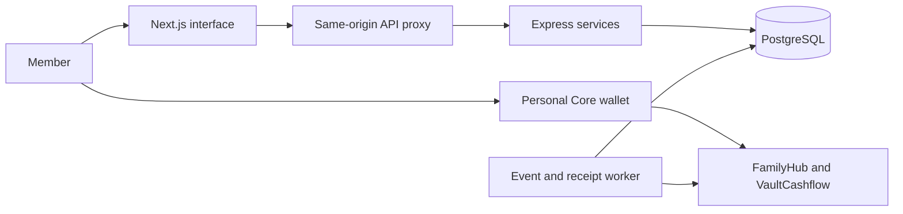

# Architecture

## Application Boundaries

The frontend provides role-based experiences. The same-origin proxy forwards application requests to Express; server-side services enforce workspace access, session state, wallet ownership, and action-specific policies. PostgreSQL stores accounts, memberships, requests, and indexed activity. The worker reconciles actual receipts and events; a database record is not proof that an on-chain payment occurred.

## Contract Paths and Custody

| Path | Asset custody | Current boundary |
| --- | --- | --- |
| FamilyHub + VaultCashflow, T1 | Contracts on a single configured chain | Native AVAX; deployment and runtime checks gate transactions. The checked-in manifest is disabled. |
| KinetixVaultV1 + factory | Individual clone contracts | Experimental alternative, not activated by the T1 manifest. Multi-approval vaults reject unilateral member edits and direct inter-vault transfers. |
| Shared Core treasury | A designated wallet controlled by its holder | Custodial application ledger with receipt reconciliation. Independent of FamilyHub deployment and on-chain multisig rules. |
| FamilyYieldVault | Standalone operator-controlled contract | Reserve-funded simulation, excluded from the T1 application deployment. |

The public manifest contains no verified contract deployment at this revision. Local deterministic addresses identify fixtures only when their local network context is established; address patterns alone cannot establish which network hosts a contract. Verified deployment evidence requires chain identity, receipts, code hashes, source identity, and wiring checks.

## Financial Rules

T1 deposits retain the received AVAX on the Hub chain. Allocation ratios are policy metadata; they do not automatically bridge principal. SHIELD separates limited withdrawals from approval-based requests. MILESTONE reserves task rewards and uses guardian quorum for payout. ROSCA requires scheduled contributions and follows a finite recipient sequence. SHARED_GOAL checks its target or deadline together with the required approvals.

Withdrawal requests have a 48-hour approval/execution window. This is an expiration period, not a mandatory 48-hour timelock. A quorum can execute a valid request before the window ends. Membership epochs invalidate old withdrawal authorizations after relevant membership changes. Guardian recovery preserves the trust assumption that a sufficient guardian quorum may replace a member wallet.

Vault V1 is a separate implementation with its own policy surface. Its restricted multi-approval administration and transfers require a future quorum-backed workflow. A V1 clone also rejects plain native transfers: an approved withdrawal directly to a clone is not a substitute for an inter-vault deposit workflow.

## Simulated Accrual

`FamilyYieldVault` uses a hypothetical **8% simple annual rate** based on elapsed seconds and principal. Its historical `APY_RATE` identifier is retained for compatibility; the formula does not itself compound and does not constitute an APY sourced from a market protocol.

The operator funds a separate reserve. Interest payout and compounding revert when that reserve is insufficient; other vaults' principal is not a source of interest. Nominal accrued amounts can exceed available reserves, so they are not a guarantee of redeemable yield. No Aave, BENQI, or other external yield strategy is integrated. The operator controls the standalone vault; it is not a production user savings product.

## Cross-Chain Research

Experimental wiring scripts and receiver tests exist, but T1 rejects cross-chain callbacks and keeps cross-chain features disabled. Wiring contracts is not evidence of a functioning asset bridge.

Avalanche ICM carries messages. Successful delivery and successful application execution are distinct; a delivered message can require an execution retry. The official [ICM Contracts documentation](https://build.avax.network/docs/cross-chain/icm-contracts/overview) describes delivery receipts, replay protection, `retryMessageExecution`, and resending. These protocol features do not establish asset settlement in this application.

Before activation, the project needs a funded asset-transfer adapter, durable message identifiers and lifecycle records, idempotent settlement, retry monitoring, and reconciliation across origin debits and destination credits. Failure tests must cover unavailable liquidity, pauses, recipient reverts, delayed execution, duplicate delivery, and interrupted relaying. Current local mocks do not validate production relayer behavior.

## L1 Permissions

Transaction AllowList is an EVM/network permission control, not a hardware security boundary. It is distinct from the Hub's own allowlist. An L1 must activate its precompile configuration and govern Admin, Manager, and Enabled roles; see Avalanche's [Transaction AllowList](https://build.avax.network/docs/avalanche-l1s/precompiles/transaction-allowlist) and [AllowList interface](https://build.avax.network/docs/avalanche-l1s/precompiles/allowlist-interface) references.

Zero-fee operation depends on verified L1 fee configuration or an implemented sponsorship mechanism. It does not apply automatically to Fuji. No verified zero-fee Family L1 configuration is shipped as an active deployment.
