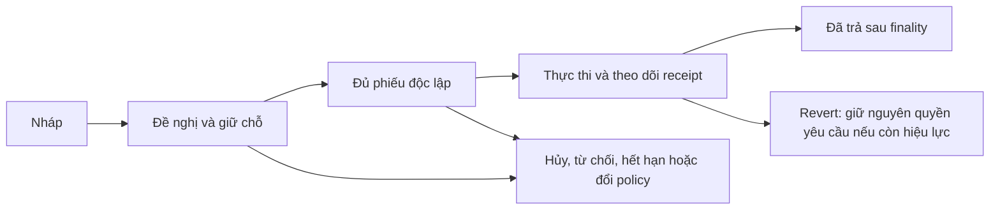

# Quỹ hoạt động và quỹ mục tiêu

Đặc tả nghiệp vụ 1.0, 15/11/2026. Đọc cùng [mô hình chung](FUND_OPERATING_MODEL.md) và [hành vi contracts V2](CONTRACTS_V2.md). Các cấu hình đề xuất cho app không tự trở thành chức năng đã triển khai.

## 1. Quỹ hoạt động

### 1.1 Mục tiêu và cấu hình

Quản lý ngân sách dùng nhiều lần cho CLB, nhóm sinh hoạt, gia đình hoặc một tổ chức nhỏ. Có thể hoạt động lâu dài, không yêu cầu có target hoặc deadline giải ngân.

| Quyết định | Đề xuất sản phẩm | Thực thi |
| --- | --- | --- |
| Ai được góp | Thành viên qua app; cần công bố V2 vẫn nhận từ ví ngoài | Contract V2 cho mọi ví deposit |
| Cách góp | Tự nguyện hoặc nghĩa vụ một lần/định kỳ | Tiền nhận on-chain; lịch/nghĩa vụ ở backend |
| Cách chi | Quorum mặc định; chi hạn mức tùy chọn, mặc định tắt | PROPOSE/APPROVE/SPEND và policy contract |
| Hạn đề nghị | App đề xuất 7 ngày, có thể chọn nhưng tối đa 30 ngày | Contract kiểm timestamp |
| Ngưỡng | Khuyến nghị 2/3 khi đủ người độc lập | V2 cho quorum >=1 và < số approver |
| Đóng/rời quỹ | Không tự rút lại contribution | Governance và chi được duyệt |
| Danh mục ngân sách | Theo dõi dự kiến, không khóa tiền ở V2 | Backend/read model |

Mẫu “Sinh hoạt gia đình”, “Quỹ hội phí” và “Chi phí chuyến đi thường xuyên” chỉ điền tên/mô tả và gợi ý trường; không tự bật SPEND, cấp quyền hoặc chọn cách chia tiền dư.

### 1.2 Thu tiền và nghĩa vụ

Một đợt thu có asset cố định, danh sách nghĩa vụ, số tiền từng người, hạn và phiên bản. Khi phát hành đợt thu phải snapshot thành viên, không tự thêm nghĩa vụ cho người mới gia nhập hồi tố.

Nộp một phần giảm số còn thiếu; nộp thừa không tạo số dư cá nhân có thể rút. Phần thừa được ghi chưa phân bổ hoặc góp thêm theo điều khoản. Miễn/giảm nghĩa vụ cần người có quyền tổ chức thu, lý do và audit; không làm biến mất tiền thực nhận.

Ví A trả giúp nghĩa vụ của thành viên B chỉ là phân bổ trên backend có bằng chứng/ủy quyền phù hợp. Contributor contract vẫn là A. Không đổi danh tính người gửi khi ghi sổ. Đặc biệt không áp dụng suy luận này để chuyển claim hoàn tiền của quỹ mục tiêu sang B.

Không đánh dấu đã đóng chỉ từ hash do client gửi. Verify chain, asset, fund, sender, amount và receipt. Một khoản nhận chỉ phân bổ một lần về tổng số tiền; sửa nhầm bằng điều chỉnh có audit, không tạo deposit giả.

### 1.3 Chi qua phê duyệt



Người đề nghị khai mục đích, số tiền, người nhận, chứng từ và deadline. App lưu nháp riêng; chỉ tạo reservation tài chính sau khi transaction đề nghị thực sự thành công. Người nhận không duyệt khoản của mình. Ngưỡng hiển thị theo số approver đủ điều kiện cho chính khoản này, không chỉ tổng approver quỹ.

Đủ quorum chưa chuyển tiền. Người thực thi trả gas cho transaction execute, không được đổi recipient, amount hoặc lấy execution fee. Trường hợp trả cho cửa hàng: recipient là ví cửa hàng; người mua hộ là người đề nghị. Trường hợp hoàn ứng: recipient là ví người đã ứng tiền, người đó không được duyệt khoản hoàn cho mình.

Nếu receipt chi revert, transaction attempt thất bại nhưng expense chưa tự REJECTED/CANCELLED. Đọc trạng thái mới nhất, deadline, pause và epoch để quyết định có thể thử execute lại không. Nếu thay số tiền/người nhận, hủy hoặc chờ giải phóng yêu cầu cũ rồi tạo mới; không sửa payload của khoản đã duyệt.

### 1.4 Chi trong hạn mức

Chỉ bật khi nhóm đồng ý cấp quyền chi độc lập. Bật SPEND là quyết định tài chính, không phải tính năng giao diện có thể tự mở. Trước ký phải hiện:

```text
Khoản tối đa lúc này = min(
  số khả dụng contract,
  hạn mức một giao dịch,
  hạn mức ngày quỹ - tổng quỹ đã chi nhanh ngày UTC,
  hạn mức ngày thành viên - thành viên đã chi nhanh ngày UTC
)
```

Đây là ước tính trước giao dịch; contract kiểm lại khi thực thi vì giao dịch khác có thể chi trước. Không đặt ba hạn mức mâu thuẫn rồi hiện một số lớn hơn quyền thực tế. Hạn ngày reset 00:00 UTC; giờ Việt Nam chỉ là cách hiển thị quy đổi. Không quảng cáo cửa sổ 24 giờ trượt.

Đề nghị quorum không chịu cap chi nhanh. Nếu muốn mọi khoản chi đều chịu ngân sách/ngày, V2 hiện chưa hỗ trợ; cần policy/contract mới. Không mô tả category budget hoặc giới hạn backend như ràng buộc on-chain.

### 1.5 Ví dụ đối soát

Đơn vị AVAX chỉ để minh họa accounting, không là khuyến nghị số tiền hoặc định giá fiat.

| Bước | A ghi nhận | R giữ chỗ | V khả dụng | Giải thích |
| --- | ---: | ---: | ---: | --- |
| Nhận góp | 100 | 0 | 100 | Nghĩa vụ chưa đóng khác không cộng vào A |
| Đề nghị trả địa điểm 30 | 100 | 30 | 70 | Tiền chưa rời quỹ |
| Chi hạn mức 5 | 95 | 30 | 65 | Không dùng phần giữ chỗ |
| Trả địa điểm thành công | 65 | 0 | 65 | Giảm A và R cùng 30 |
| Gửi 10 AVAX bằng cách ép nhận | 65 | 0 | 65 | Native thực tế 75, surplus U=10 |

Khi kết thúc, 65 còn lại không tự trả theo tỷ lệ tổng contribution. Nhóm áp dụng điều khoản, duyệt từng khoản chi hợp lệ và đối soát. V2 chưa có batch chia tiền dư hoặc chuyển nội bộ giữa fund bằng bút toán.

## 2. Quỹ mục tiêu

### 2.1 Định nghĩa mục tiêu

Mẫu V2 là **đạt ngưỡng tiền thì mở quyền đề nghị chi**, không phải crowdfunding có bảo đảm giao hàng. Hai bên vẫn phải tin quorum sử dụng tiền đúng mục đích sau khi target đạt.

Target và deadline nhận góp được chốt trước tạo, không sửa được. Amount dùng đơn vị native, không phải VND cố định. Hạn dự kiến tổ chức sự kiện nằm ở metadata, không thay deadline góp contract.

Mẫu “Du lịch”, “Mua dụng cụ” hoặc “Sự kiện” chọn GOAL. Không cho cấu hình “được chi trước khi đủ”, “gia hạn trực tiếp” hoặc “hoàn tự động sau khi đã đạt” vì V2 không enforce các lựa chọn đó.

### 2.2 Bảng quyết định

| Tình huống | Góp thêm | Đề nghị chi | Hoàn thất bại |
| --- | --- | --- | --- |
| Trước hạn, chưa đạt | Có | Không | Không |
| Trước hạn, đã đạt | Có, V2 không hard-cap | Có, vẫn cần quorum | Không |
| Đúng/sau hạn, chưa từng đạt | Không | Không | Người góp tự claim |
| Đúng/sau hạn, đã đạt trước đó | Không | Có, vẫn cần quorum | Không |
| Đang pause | Không | Không | Không đến khi quorum resume |
| Đã đóng | Không | Không | Không còn backing được ghi nhận để claim |

Một deposit phải vào block có timestamp nhỏ hơn deadline. Gửi vào mempool trước hạn không bảo đảm được chấp nhận trước hạn. Số dư native thực tế bị ép gửi không được tính vào target. Mốc hoàn thành dựa trên accountedBalance khi deposit, không dựa trên nghĩa vụ góp hoặc giá thị trường.

### 2.3 Góp vượt mục tiêu

V2 chấp nhận toàn bộ deposit làm vượt target và tiếp tục nhận góp cho tới deadline. Mặc định UI chỉ gợi ý phần còn thiếu và giải thích nếu người gửi chọn nhiều hơn; không gắn nhãn “chỉ nhận tối đa target”. Hai người cùng thấy phần còn thiếu có thể cùng gửi và làm vượt.

Hard cap, tự hoàn phần thừa và tự đóng nhận góp khi đạt là tính năng contract khác, chưa có. Không cắt số tiền đã nhận trong DB để làm progress đẹp hơn. Thanh tiến độ có thể dừng ở 100% về hình ảnh nhưng phải thể hiện tổng đã góp và phần vượt bằng số thật.

### 2.4 Thành công và sử dụng

`goalReached` latch true khi đạt. Sau đó có thể chi nhiều lần qua quorum, kể cả khiến A thấp hơn target. Progress mục tiêu dùng cờ thành công và dòng góp đã đối soát; số khả dụng dùng A-R hiện tại. Không dùng A hiện tại làm người dùng tưởng mục tiêu “tụt về chưa đạt” sau giải ngân.

Hoàn thành mục đích thực tế là quyết định nghiệp vụ có chứng từ, không phải `goalReached`. Đạt tiền chưa đồng nghĩa đã mua được dụng cụ hoặc tổ chức xong sự kiện. Hoàn thành mục đích cũng không tự đóng contract.

### 2.5 Thất bại và claim hoàn

Nếu hết hạn mà chưa từng đạt, mỗi ví lấy lại contribution còn ghi nhận của mình bằng `refundFailedGoal`. Không cần phiếu chi, không có phí dịch vụ V2 và người claim tự trả gas. Không có tự động chuyển tiền theo đồng hồ, không có deadline claim trong V2 và không được đóng khi A vẫn còn claim chưa nhận.

Claim đi về ví đã deposit. Nếu A góp giúp nghĩa vụ B, quyền claim vẫn ở A. Wallet recovery qua thay member không chuyển contribution mapping sang ví mới; mất khóa ví góp có thể mất khả năng claim. App phải nêu rõ điều này trước góp, không hứa chức năng đổi ví người nhận hoàn chưa tồn tại.

Pause chặn claim. Quorum có thể resume nhưng không có admin cưỡng chế khi mất quorum. Ví contract từ chối native transfer có thể làm claim revert; backing và claim còn nguyên để thử lại khi ví nhận được. Không đổi recipient qua API để né điều kiện contract.

Ví dụ target 100: ví A góp 40, B góp 35, hết hạn chưa đạt. A claim 40 làm A_balance từ 75 xuống 35; B còn quyền 35, không nhận phần tỷ lệ từ số dư sau claim của A. Forced surplus 10 không cộng vào claim của ai và cần governance riêng.

### 2.6 Sau khi đã đạt nhưng kế hoạch bị hủy

V2 không có tự động chuyển về chế độ FAILED. Quyền hoàn sau thành công phải giải quyết qua điều khoản và các khoản chi được duyệt. Muốn bảo đảm hoàn theo tỷ lệ khi hủy sự kiện sau thành công phải thiết kế contract/version khác trước nhận tiền; một checkbox trong wizard không đủ.

Không tự lấy `contributions(wallet)` làm số được hoàn sau khi quỹ đã chi: tổng contribution có thể lớn hơn tài sản còn lại. Cần phương án phân bổ phần dư và xử lý chi phí đã phát sinh, được nhóm chấp thuận và ghi nhận.

## 3. Chính sách chung bắt buộc công bố

Trước góp phải đọc được: tài sản/mạng, nơi giữ tiền, ai có quyền chi, số phiếu cần, khả năng chi hạn mức, điều kiện hoàn, tác động mất khóa/quorum, cách xử lý tiền dư và phí mạng. Nội dung ngắn ở bước quyết định, điều khoản đầy đủ mở riêng và có phiên bản/hash.

Không hứa tranh chấp được giải quyết tự động bởi blockchain. Receipt chứng minh chuyển tiền, không chứng minh hóa đơn đúng, công việc hoàn thành hoặc hàng hóa được giao.
