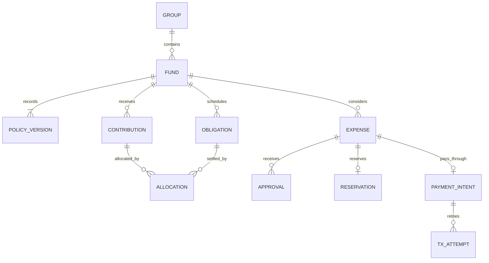
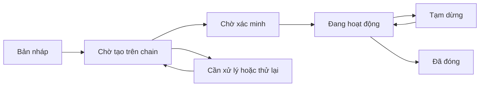

# Mô hình hoạt động và quản lý quỹ Kinetix

Phiên bản mô hình: 1.0 · 15/11/2026. Đây là đặc tả sản phẩm và nghiệp vụ để thiết kế contracts, backend và frontend thống nhất. Không phải xác nhận phát hành hoặc ý kiến pháp lý. Hành vi V2 hiện có được đối chiếu riêng, không thay đổi bằng việc sửa tài liệu.

## 1. Quyết định nền tảng

Kinetix quản lý tiền của một nhóm theo mục đích và quy tắc đã thống nhất. Tên gọi trong sản phẩm là **Quỹ**. “Hũ” là cách diễn đạt tùy ngữ cảnh, không phải một thực thể tài chính khác.

Một quỹ có một nhóm quản lý, một tài sản gốc, một cơ chế giữ tiền và một bộ quy tắc có phiên bản. Không gộp các quỹ khác chain, khác token hoặc khác người giữ tiền thành một số dư có thể sử dụng chung.

Ba lớp phải tách biệt:

| Lớp | Trả lời | Ví dụ |
| --- | --- | --- |
| Mục đích | Góp để làm gì? | Sinh hoạt CLB, chuyến đi, hỗ trợ người thân |
| Cơ chế tài chính | Khi nào và bằng cách nào tiền được sử dụng? | Chi qua duyệt, mở chi sau mục tiêu, trả theo kết quả, trả theo lượt |
| Quyền | Ai được làm việc gì trong quỹ này? | Đề nghị, duyệt, chi hạn mức, thay chính sách |

“Gia đình”, “CLB”, “nhóm bạn” là loại nhóm và gợi ý mẫu. Chúng không quyết định quyền tiền. Cùng mẫu Quỹ hoạt động có thể phục vụ cả ba.

## 2. Bốn mô hình nghiệp vụ

| Mô hình | Dòng tiền chính | Điều kiện chi | Quyền hoàn mặc định | Phạm vi |
| --- | --- | --- | --- | --- |
| Hoạt động | Góp → ngân sách → chi | Quorum hoặc hạn mức được cấp | Không tự động | Ưu tiên triển khai |
| Mục tiêu | Góp → kiểm tra mục tiêu → chi/hoàn | Đạt mục tiêu rồi duyệt | Hoàn về người góp nếu hết hạn chưa đạt | Ưu tiên triển khai |
| Nhiệm vụ/cột mốc | Ngân sách → giữ chỗ → xác nhận → trả | Kết quả được xác nhận và chi được duyệt | Theo điều khoản; không mặc định cho nhà tài trợ | Thiết kế mở rộng |
| Góp xoay vòng | Góp theo kỳ → trả theo lượt | Điều kiện kỳ và thứ tự cố định | Không thể hứa hoàn toàn bộ sau khi đã trả một lượt | Chưa phát hành |

Chi trong hạn mức là khả năng tùy chọn của Quỹ hoạt động. Mục tiêu tiết kiệm hiển thị trong Quỹ hoạt động chỉ là thông tin, không trở thành khóa giải ngân. Một đợt đóng hội phí cũng không biến Quỹ hoạt động thành ROSCA.

Phiên bản đầu chỉ cho tạo Hoạt động và Mục tiêu. Hai mô hình còn lại phải có đặc tả điều kiện và khả năng thực thi riêng trước khi xuất hiện như lựa chọn sử dụng thật.

## 3. Đối tượng chung

| Đối tượng | Nội dung bắt buộc | Không được hiểu nhầm |
| --- | --- | --- |
| Nhóm | Thành viên và quyền tổ chức | Không trực tiếp sở hữu quyền ký của mọi quỹ |
| Quỹ | Mục đích, tài sản, binding giữ tiền, chính sách | Không phải tài khoản cá nhân của người tạo |
| Chính sách | Quyền, ngưỡng, hạn mức, chi/hoàn, đóng và phiên bản | Nhãn UI không tạo ra thực thi contract |
| Khoản phải góp | Người có nghĩa vụ, kỳ, số tiền, hạn | Chưa phải tiền đã có |
| Khoản góp | Người gửi, tài sản, số tiền thực nhận và bằng chứng | Không tự tạo shares hoặc quyền biểu quyết |
| Phân bổ góp | Liên kết khoản nhận với nghĩa vụ | Không được nhân bản một khoản nhận thành nhiều tiền |
| Đề nghị chi | Người nhận/số tiền/tài sản/quỹ/deadline/policy cố định | Không phải lệnh đã chuyển tiền |
| Reservation | Khoản giữ chỗ có owner và vòng đời | Không cộng thêm vào tổng tài sản |
| Phê duyệt | Người duyệt, quyết định, policy context | Không đồng nghĩa đã trả hoặc đánh giá đúng sự thật |
| Thanh toán | Intent, các tx attempt, kết quả và finality | Timeout chưa chứng minh thất bại |
| Điều chỉnh/đối soát | Lý do, bằng chứng, bút toán sửa | Không sửa lịch sử receipt để khớp số mong muốn |

Một khoản góp có thể thanh toán nhiều nghĩa vụ hoặc một phần nghĩa vụ. Tổng phân bổ không vượt khoản nhận còn hợp lệ. Hoàn tiền và reorg phải đảo/điều chỉnh phân bổ liên quan; không giữ nghĩa vụ PAID khi khoản góp làm bằng chứng đã mất hiệu lực.



ER này mô tả quan hệ nghiệp vụ đề xuất, không yêu cầu một bảng tương ứng mỗi hộp và không thay schema hiện hành. Claim hoàn, chi hạn mức và surplus cũng có payment intent riêng, không cần tạo expense giả để ép vào quan hệ EXPENSE. Một expense có tối đa một intent settlement hiệu lực, intent có thể có nhiều attempt.

## 4. Nguồn sự thật và nơi giữ tiền

| Lớp dữ liệu | Nguồn quyết định |
| --- | --- |
| Tiền và quyền của quỹ V2 | Contract trên chain xác định, receipt canonical theo finality policy |
| Danh tính, thành viên nhóm, nghĩa vụ góp, chứng từ | Backend có kiểm soát quyền và lịch sử thay đổi |
| Chi từ ví chung cá nhân | Chủ ví thực thi; app chỉ tổ chức quyết định và đối soát |
| VND/USD tham khảo | Quote có nguồn và thời điểm; không thay đơn vị ký giao dịch |

Binding quỹ phải có `chainId`, `assetAddress` (zero cho native), `assetDecimals`, `custodyAdapter`, địa chỉ contract/ví và phiên bản được xác minh. Mã DB và fundId nội bộ không thay thế binding.

Đề xuất tên adapter rõ nghĩa: `FUND_V2_NATIVE`, `HUB_T1_NATIVE`, `VAULT_V1_NATIVE`, `CUSTODIAL_WALLET`. Đây là tên mô hình đích, không tuyên bố các enum/API hiện tại đã có. Không dùng một nhãn “on-chain” để suy ra mọi adapter có cùng quyền hoặc điều kiện hoàn.

## 5. Quyền và trách nhiệm

| Hành động | Quyền tổ chức | Quyền tài chính cần có |
| --- | --- | --- |
| Đổi ảnh/tên nhóm | Quản lý nhóm | Không tự đổi contract |
| Góp AVAX vào V2 | Không cần là member on-chain | V2 nhận góp công khai qua deposit |
| Gửi đề nghị chi | Quyền truy cập ứng dụng | PROPOSE trong đúng quỹ |
| Duyệt chi | Quyền truy cập ứng dụng | APPROVE, khác địa chỉ nhận |
| Chi trong hạn mức | Quyền truy cập ứng dụng | SPEND và còn mọi hạn mức |
| Thực thi đề nghị đủ duyệt | App có thể tổ chức tác vụ | V2 cho bất kỳ địa chỉ nào thực thi đúng đề nghị |
| Đổi người ký/chính sách | Không do owner nhóm tự quyết | Quorum cũ, timelock và epoch mới |
| Xóa thành viên khỏi nhóm | Theo quản trị nhóm | Không tự thu hồi quyền on-chain |
| Đóng quỹ | Đề xuất trong ứng dụng | Điều kiện quỹ rỗng và governance hợp lệ |

App chỉ kiểm soát truy cập vào app. Khi quyền DB đã bị thu hồi nhưng quyền chain còn tồn tại, người đó vẫn có thể gọi contract trực tiếp. Giao diện phải hiện “Đang chờ thu hồi quyền trên chain”; không báo hoàn tất bàn giao khi mới sửa DB.

V2 kiểm tra địa chỉ riêng biệt, không kiểm tra người thật riêng biệt. Một người giữ nhiều ví có thể nắm quorum. Người đề nghị có APPROVE được duyệt khoản trả cho bên khác; không mô tả V2 là cơ chế bắt buộc người đề nghị khác người duyệt. Mẫu UI khuyến nghị 2/3 nếu có đủ ba người; không tự tạo ví để đạt số lượng.

## 6. Số tiền và nghĩa vụ

Các số tài chính lưu bằng số nguyên đơn vị nhỏ nhất. Chỉ format khi hiển thị; không dùng số AVAX dạng floating point làm payload ký hoặc nguồn tính sổ.

```text
A = số dư quỹ ghi nhận
R = reservation đang nằm trong sổ contract
V = A - R
U = số dư native thực tế - A (surplus chưa phân bổ)

Invariant V2: 0 <= R <= A <= số dư native thực tế
```

V là số khả dụng theo contract, chưa chắc là số mà người đang xem được phép chi. Số chi nhanh tối đa còn bị chặn bởi hạn mức giao dịch, thành viên, toàn quỹ và trạng thái quỹ. Không đặt nhãn “Tiền của bạn” lên V hoặc contribution lịch sử.

V2 chỉ giải phóng reservation cùng epoch đã hết hạn khi có transaction cleanup; đổi policy giải phóng reservation cũ O(1). Backend có thể biết đề nghị đã EXPIRED nhưng vẫn phải giữ đúng R/V contract cho tới receipt cleanup. Có thể hiện “20 AVAX chờ giải phóng”; không cho ký dựa trên số khả dụng dự kiến.

Nghĩa vụ góp còn thiếu không cộng vào A. Tổng góp lịch sử, ngân sách danh mục, tổng chi lịch sử, quyền hoàn và surplus là các thước đo riêng. Phí gas do người ký trả ngoài khoản chi V2; không tự trừ tiếp phí khỏi A.

## 7. Trạng thái nhiều chiều



Bản nháp/triển khai/xác minh thuộc setup ứng dụng; ACTIVE/PAUSED/CLOSED phản ánh trạng thái contract được kiểm chứng. “Lưu trữ” chỉ ẩn khỏi danh sách thường dùng, không phải đóng contract, dừng nhận tiền hoặc xóa nghĩa vụ. “Đang kết thúc” là kế hoạch off-chain trong V2, chưa khóa deposit trên chain.

| Chiều | Ví dụ trạng thái |
| --- | --- |
| Mục tiêu | Đang góp, đã đạt, hết hạn chưa đạt, còn claim hoàn |
| Đề nghị chi | Draft, pending, approved, cancelled, rejected, expired, invalidated, executed |
| Thanh toán | Chờ ký, đã phát mạng, đang xác minh, confirmed, reverted, cần đối soát |
| Nghĩa vụ góp | Chưa đóng, đóng một phần, đủ, miễn/giảm, hủy; quá hạn là thuộc tính theo thời gian |
| Tích hợp | Chưa verified, đồng bộ, dữ liệu cũ, cần đối soát |

Không ép các chiều thành một enum chung. Quỹ có thể đã đạt mục tiêu, đang pause và có giao dịch trước đó chờ finality. `EXECUTED` tại một block chưa được app coi confirmed nếu finality policy chưa đạt.

## 8. Thay đổi và kết thúc

Phân biệt metadata với policy. Sửa tên hiển thị không sửa đích chi; sửa người nhận/số tiền/tài sản của đề nghị cần tạo đề nghị mới. Thay terms liên quan quyền tài chính phải được version hóa, hiển thị diff và áp dụng đúng governance; backend không thể biến điều khoản chữ thành điều kiện enforce chưa có.

Trong V2, policy mới hủy hiệu lực toàn bộ đề nghị chi/governance cũ chưa hoàn tất; pause không đóng băng deadline. Target, deadline, loại quỹ, asset và chain không đổi sau tạo. Muốn đổi các giá trị bất biến phải tạo quỹ mới và xử lý quỹ cũ minh bạch; không relabel để giả lập chuyển đổi.

Trước đóng: đối soát receipt → xử lý đề nghị/reservation → trả/hoàn tiền hợp lệ → xử lý claim còn lại → kiểm A=0, R=0, không pause → quorum + timelock → receipt đóng. Quỹ rỗng không tự chứng minh mọi nghĩa vụ ngoài chain đã được giải quyết; báo cáo phải liệt kê tranh chấp hoặc khoản chưa đóng còn lại.

Giới hạn liveness hiện tại: V2 OPERATING nhận góp công khai khi open. Trong lúc chờ đóng, một ví khác vẫn có thể deposit dù app đã ngừng hiện nút góp; khoản mới khiến điều kiện A=0 không còn đúng. Không hứa đóng chắc chắn theo deadline. Muốn kết thúc nhận góp nhưng vẫn cho giải ngân cần mode WINDING_DOWN được contract thực thi ở phiên bản tương lai; pause hiện tại không thay thế được vì chặn cả outflow và close.

## 9. Tài liệu chi tiết và thứ tự thực thi

- [Quỹ hoạt động và mục tiêu](FUND_MODELS_CORE.md): quy tắc, tình huống và ví dụ tiền.
- [Nhiệm vụ/cột mốc và xoay vòng](FUND_MODELS_EXTENSIONS.md): điều kiện bảo đảm và giới hạn dùng chung.
- [Tạo và quản lý chung trên điện thoại](FUND_CREATION_MANAGEMENT.md): cấu hình, màn hình, capability và hợp đồng dữ liệu.
- [Ma trận nghiệm thu và quyết định](FUND_MODEL_ACCEPTANCE.md): test nghiệp vụ, khoảng cách V2 và backlog có thứ tự.

Ưu tiên: tích hợp Hoạt động và Mục tiêu đúng V2, sau đó chứng minh nhu cầu nhiệm vụ trước khi thêm escrow/cột mốc; ROSCA chỉ đi tiếp khi đã chốt mô hình thiếu góp, dừng giữa chừng và nguồn bảo đảm. Không xây bộ máy policy tùy ý để hỗ trợ mọi tổ hợp ngay từ đầu.
