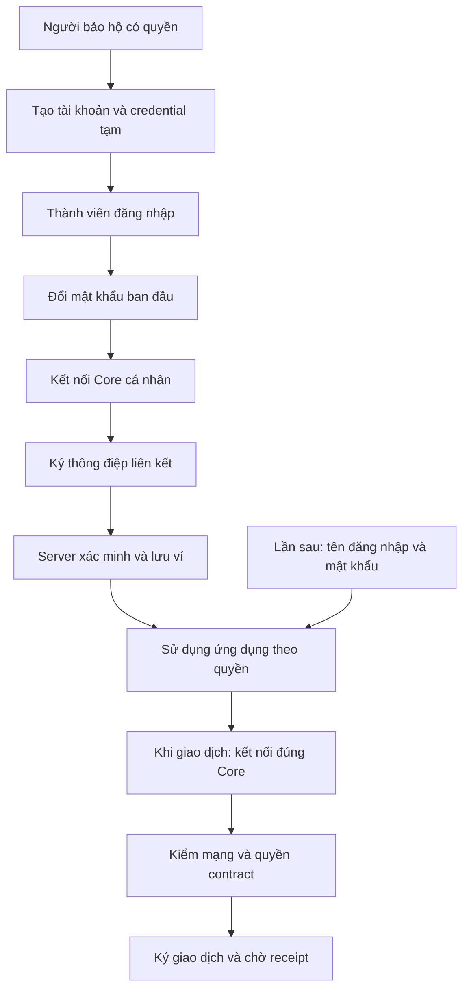

# Kinetix — Kế hoạch tài khoản do người bảo hộ tạo và liên kết Core Wallet

Ngày cập nhật: 04/11/2026. Phiên bản 2, thay thế đề xuất trước trong tài liệu này theo yêu cầu mới. Trạng thái: kế hoạch, chưa thay đổi mã nguồn hoặc dữ liệu.

## 1. Mục tiêu và phạm vi đã chốt

Người bảo hộ tạo tài khoản ứng dụng cho người già và trẻ nhỏ để quản lý. Thành viên nhận tên đăng nhập và mật khẩu ban đầu, đăng nhập, sau đó liên kết ví Core cá nhân trước khi sử dụng. Những lần sau, thành viên đăng nhập bằng tài khoản bình thường, sử dụng các tính năng được phép mà không cần kết nối ví; khi giao dịch thì kết nối đúng ví Core đã liên kết và xác nhận giao dịch.

Giữ Next.js App Router, Express, Neon PostgreSQL, Drizzle và Viem. Xác thực ứng dụng bằng tên đăng nhập/mật khẩu và cookie phiên. Core là ví cá nhân do thành viên quản lý. Không cần Privy, Google OAuth, passkey, ví nhúng hoặc backend giữ khóa trong phạm vi này.

Lựa chọn mặc định của kế hoạch: tên đăng nhập duy nhất toàn hệ thống và mật khẩu, không dùng họ tên hoặc PIN 4 số để xác thực. Người bảo hộ được tạo credential ban đầu cho người phụ thuộc, nhưng hệ thống chỉ lưu hash mật khẩu. Mật khẩu ban đầu là tạm thời, có hạn dùng và phải đổi trước khi liên kết ví. Bước này nằm trong màn hình kích hoạt lần đầu.

Đăng ký người bảo hộ vẫn tận dụng luồng Core SIWE hiện có: chứng minh sở hữu ví, tạo tài khoản đăng nhập và tạo/tham gia workspace theo quyền hợp lệ. Người bảo hộ đã có trong hệ thống được bổ sung credential qua phiên xác thực hợp lệ và xác thực lại bằng ví. Không tự cấp quyền Guardian qua form chọn vai trò hay mã gia đình công khai.

## 2. Hai lớp độc lập: tài khoản ứng dụng và ví

| Thành phần | Trách nhiệm |
|---|---|
| Tài khoản Kinetix | Xác thực người dùng, hồ sơ, membership, người bảo hộ quản lý, trạng thái hoạt động và quyền API |
| Liên kết ví Core | Lưu địa chỉ đã chứng minh sở hữu; dùng để đối chiếu signer khi giao dịch |
| Kết nối ví trên thiết bị | Phiên kết nối của Core với trình duyệt; có thể mất khi đóng trình duyệt, đổi thiết bị hoặc disconnect |
| Smart contract và allowlist | Quyết định địa chỉ được tương tác trên mạng và quyền thực hiện thao tác đối với từng hũ |

Liên kết ví được lưu ở server và tồn tại qua các lần đăng nhập. Kết nối ví là trạng thái tại thiết bị. Disconnect không xóa liên kết ví hoặc đăng xuất tài khoản. Logout xóa phiên ứng dụng và cache, ngừng sử dụng provider trong UI; không hứa ứng dụng thu hồi được quyền kết nối mà extension giữ.

Một tài khoản có thể là thành viên nhiều workspace; quyền của người bảo hộ và quyền của thành viên được giới hạn theo workspace/hũ. MVP dùng một ví Core đang hoạt động cho mỗi tài khoản, một địa chỉ không được liên kết với hai tài khoản khác nhau. Ví EVM có thể dùng cùng địa chỉ trên Fuji và Family L1; trạng thái cấp quyền theo từng mạng được kiểm riêng.

## 3. Quy trình người bảo hộ tạo tài khoản

1. Người bảo hộ đăng nhập và vào đúng workspace, mở mục “Thành viên được quản lý”.
2. Chọn “Tạo tài khoản”, nhập họ tên, tên đăng nhập và loại thành viên: người già hoặc trẻ nhỏ. Số điện thoại là thông tin tùy chọn, không bắt buộc trẻ nhỏ phải có email/SĐT.
3. Backend kiểm người gọi có quyền quản lý thành viên tại workspace này. Vai trò Guardian của một hũ không tự cho phép quản lý toàn bộ workspace.
4. Tạo user, credential tạm, membership và quan hệ người bảo hộ–thành viên trong một transaction; chống tạo trùng khi nhấn lại. Không sinh địa chỉ ví thay thành viên.
5. Hệ thống hiển thị credential ban đầu một lần để người bảo hộ bàn giao trực tiếp. Nếu người bảo hộ nhập mật khẩu ban đầu, mật khẩu vẫn phải đạt chính sách và hệ thống chỉ lưu hash. Sau đó chỉ có thể cấp lại credential tạm, không xem mật khẩu đã lưu.
6. Tài khoản xuất hiện với trạng thái “Chờ đăng nhập lần đầu”. Chưa gán quyền chi tiền cho một địa chỉ chưa liên kết.

Người tạo tài khoản là người quản lý ban đầu. Có thể thêm/chuyển người quản lý theo quyền Admin của workspace, có audit log. Không mặc định mọi Guardian được đặt lại mật khẩu cho mọi thành viên. Người bảo hộ có thể biết credential lúc bàn giao; việc đổi mật khẩu và đăng nhập lại là bước chuyển quyền sử dụng tài khoản cho thành viên.

## 4. Thành viên kích hoạt lần đầu

1. Thành viên mở trang đăng nhập, nhập tên đăng nhập và mật khẩu người bảo hộ cấp.
2. Server xác minh credential, cấp phiên onboarding giới hạn; chưa cho truy cập chức năng sử dụng thông thường.
3. Nếu là mật khẩu tạm, thành viên đặt mật khẩu cá nhân; thu hồi credential/phiên tạm cũ và xoay phiên.
4. Màn hình hướng dẫn “Kết nối ví Core cá nhân”. Nếu chưa cài hoặc chưa có ví, hướng dẫn mở/cài Core và tạo ví trong Core; tài khoản tiếp tục ở trạng thái chờ, Kinetix không nhận seed phrase/private key.
5. Thành viên kết nối Core, kiểm tra địa chỉ được hiển thị và ký thông điệp liên kết. Chỉ kết nối hoặc gửi chuỗi địa chỉ lên server chưa chứng minh quyền sở hữu.
6. Server xác minh thông điệp SIWE và chữ ký, kiểm user/session/mục đích của challenge, nonce dùng một lần, domain/URI, thời gian và chain được phép. Việc liên kết không yêu cầu gửi giao dịch on-chain hay nạp tiền.
7. Trong transaction DB, kiểm lại tài khoản chưa bị khóa, liên kết địa chỉ duy nhất và tiêu thụ challenge nguyên tử; cập nhật trạng thái tài khoản, ghi audit và thông báo cho người bảo hộ.
8. Nếu Family L1 yêu cầu allowlist hoặc hũ cần gán Beneficiary, tạo yêu cầu thiết lập on-chain riêng cho operator/Guardian có thẩm quyền. Hiển thị “Đang cấp quyền giao dịch” cho đến khi receipt và trạng thái contract được xác nhận. Không đánh dấu thành công chỉ từ một cột boolean DB.
9. Sau khi liên kết ví thành công, thành viên vào giao diện theo membership. Các thao tác tài chính cần quyền on-chain vẫn chờ đến khi được cấp quyền thực tế.

SIWE ở đây chứng minh sở hữu ví để liên kết với tài khoản đã đăng nhập, không thay thế đăng nhập bằng mật khẩu của thành viên. Thông điệp/challenge phải nêu rõ mục đích liên kết và được ràng buộc server-side với tài khoản/phiên đang kích hoạt. Tham khảo [ERC-4361](https://eips.ethereum.org/EIPS/eip-4361).

## 5. Những lần sử dụng sau

### 5.1. Đăng nhập và xem dữ liệu

- Thành viên chỉ nhập tên đăng nhập và mật khẩu, không cần mở Core hay ký SIWE lại.
- Nếu tài khoản đã liên kết ví và còn quyền, truy cập dashboard, thông báo, nhiệm vụ và dữ liệu được phép. Dữ liệu on-chain công khai có thể đọc qua public client, không cần signer.
- Thiết bị mới không bắt liên kết lại ví; hiển thị địa chỉ đã liên kết và trạng thái “Chưa kết nối trên thiết bị này”.
- Nếu chưa hoàn tất kích hoạt, luôn đưa về bước còn thiếu; không tạo tài khoản/ví mới.

### 5.2. Giao dịch

1. Thành viên chọn hành động tài chính.
2. Nếu chưa có kết nối, yêu cầu kết nối Core.
3. Đối chiếu địa chỉ ví hiện tại với địa chỉ đã liên kết. Nếu sai, yêu cầu đổi đúng tài khoản trong Core; không tự sửa liên kết trong DB.
4. Kiểm chain, allowlist và quyền hũ; hướng dẫn chuyển mạng phù hợp.
5. Hiển thị nội dung giao dịch và yêu cầu xác nhận trong Core. Thông thường không có thêm chữ ký SIWE cho mỗi giao dịch.
6. Theo dõi tx hash và receipt; chỉ báo hoàn tất khi receipt thành công và đối soát được sự kiện/trạng thái cần thiết. Backend không coi walletAddress do client gửi là bằng chứng giao dịch.

Lắng nghe account/chain/disconnect: ngừng khởi tạo giao dịch khi signer không khớp, xóa cache phụ thuộc và kiểm lại điều kiện khi reconnect. Giao dịch đã broadcast vẫn phải được theo dõi theo tx hash dù người dùng đổi account hoặc đóng kết nối.

## 6. Chức năng quản lý của người bảo hộ

| Chức năng | Phạm vi và hành vi |
|---|---|
| Tạo tài khoản | Chỉ người già/trẻ nhỏ và workspace được cấp quyền; không tạo Admin/Guardian qua API này |
| Xem thành viên được quản lý | Hồ sơ, trạng thái kích hoạt, ví đã liên kết, quyền và dữ liệu mà người quản lý được phép xem |
| Sửa hồ sơ | Tên hiển thị và thông tin liên hệ; không sửa ví bằng API profile |
| Cấp lại mật khẩu | Xác thực lại người bảo hộ, cấp credential tạm có hạn, buộc đổi, thu hồi phiên thành viên cũ, ghi log/thông báo |
| Khóa truy cập ứng dụng | Tạm khóa quyền truy cập thành viên được quản lý trong workspace; toàn bộ API liên quan phải áp dụng |
| Quản lý nhiệm vụ/hạn mức | Theo quyền hũ và contract hiện có, không chỉ thay số hiển thị trên UI |
| Chuyển người quản lý | Theo quyền Admin, kiểm người nhận hợp lệ, có audit log |
| Theo dõi hoạt động | Lịch sử kích hoạt, cấp lại mật khẩu, đổi trạng thái và giao dịch đã xác minh theo phạm vi được phép |

Đặt lại mật khẩu không đổi ví, không cho phép liên kết đè ví đã có. Việc khóa quyền ứng dụng của một workspace không được làm mất quyền ở workspace khác. Admin hệ thống mới có quyền đình chỉ user toàn hệ thống theo policy riêng.

Khóa tài khoản/thu hồi membership trong ứng dụng không tự thu hồi quyền trên blockchain: người giữ ví vẫn có thể gọi contract trực tiếp nếu contract còn cho phép. Nếu sản phẩm cần khóa giao dịch, phải có cơ chế thu hồi/pause quyền on-chain phù hợp, được thực hiện và xác nhận riêng. UI cần thể hiện rõ “đã khóa truy cập” và trạng thái quyền giao dịch thực tế.

## 7. Đổi ví, quên mật khẩu và mất ví

- Quên mật khẩu: người bảo hộ được phân công cấp credential tạm sau khi xác thực lại; thành viên đổi mật khẩu, giữ nguyên user ID, membership và ví đã liên kết.
- Còn dùng được ví cũ và muốn đổi: xác thực lại tài khoản, chứng minh sở hữu ví cũ và ví mới; yêu cầu quyền duyệt phù hợp; cập nhật các role/allowlist/recipient on-chain cần thiết trước khi chuyển liên kết hoạt động.
- Mất khóa ví cũ: đi qua quy trình recovery contract nếu contract hỗ trợ và người có quyền duyệt chấp nhận; không chỉ dùng mật khẩu hoặc thao tác của người bảo hộ để đổi địa chỉ trong DB.
- Không có cơ chế recovery on-chain: báo đúng giới hạn; đặt lại mật khẩu không khôi phục private key hoặc tự di chuyển tài sản.
- Không cho xóa liên kết rồi gắn ví tùy ý. Ví mới đang thuộc tài khoản khác phải bị từ chối bằng ràng buộc DB.

## 8. Trạng thái và kiến trúc

Ba nhóm trạng thái được lưu riêng:

| Nhóm | Ví dụ |
|---|---|
| Credential/tài khoản | Mật khẩu tạm, cần đổi mật khẩu, hoạt động, đình chỉ hệ thống |
| Ví | Chưa liên kết, đã xác minh, đang yêu cầu thay ví |
| Quyền workspace/on-chain | Membership hoạt động/bị khóa; allowlist hoặc role đang chờ/đã xác nhận/thất bại theo từng mạng/hũ |

Trạng thái kết nối Core chỉ nằm ở client, không dùng làm trạng thái kích hoạt toàn hệ thống. Nếu cùng user tham gia nhiều workspace, onboarding theo user và quyền từng workspace được kiểm độc lập.

Next.js làm giao diện/BFF cùng origin; Express giữ AuthService và permission policy thống nhất. BFF chuyển credential phiên tới backend, backend tự xác minh. Mọi API Next.js/Express đều dùng cùng guard và không tin role/user ID client tự khai. Hợp nhất schema/service đang trùng; worker dùng service identity riêng.

Mật khẩu hash bằng Argon2id theo cấu hình được đánh giá trên runtime thực tế, không lưu rõ hoặc mã hóa có thể giải ngược. Session dùng token ngẫu nhiên opaque trong cookie HttpOnly/Secure/SameSite phù hợp; DB lưu hash, hạn dùng và trạng thái thu hồi. Thêm rate limit theo account/IP bằng trạng thái dùng chung, thông báo lỗi đăng nhập chung, Origin/CSRF checks và audit log không chứa credential. Theo [OWASP Authentication](https://cheatsheetseries.owasp.org/cheatsheets/Authentication_Cheat_Sheet.html) và [Session Management](https://cheatsheetseries.owasp.org/cheatsheets/Session_Management_Cheat_Sheet).

## 9. Dữ liệu và API dự kiến

| Bảng | Thay đổi |
|---|---|
| users | User ID ổn định, hồ sơ, trạng thái toàn hệ thống; bỏ yêu cầu phải có ví ngay lúc tạo |
| user_credentials | Username chuẩn hóa unique, passwordHash, trạng thái/hạn credential tạm, thời điểm đổi mật khẩu |
| user_wallets | Địa chỉ EVM chuẩn hóa unique, userId, linkedAt, verifiedAt, trạng thái; mỗi user một ví hoạt động |
| guardian_member_links | Guardian, member, workspace, phạm vi quản lý, người tạo quan hệ, trạng thái; có thể nhiều người quản lý được phân công |
| workspace_members / vault_members | Role đúng phạm vi; unique/FK; phân biệt membership UI với role hũ on-chain |
| sessions | Hash token, user, hạn tuyệt đối/không hoạt động, loại phiên onboarding/full, revokedAt |
| auth_challenges | Nonce, user/session, mục đích link/relink, địa chỉ dự kiến, domain/URI/chain, hạn dùng, thời điểm tiêu thụ |
| provisioning_requests | Việc cấp/thu hồi quyền on-chain, mạng/hũ, trạng thái, tx hash, idempotency key; dùng lại hạ tầng tương đương nếu đã có |
| audit_logs | Ai tạo/sửa/reset/khóa/liên kết ví; không ghi mật khẩu, token, seed phrase hoặc private key |

Các đường dẫn sau là API public dự kiến qua BFF; backend thực hiện cùng nghiệp vụ sau guard:

- POST /api/auth/login; GET /api/auth/me; POST /api/auth/logout.
- POST /api/auth/change-password; GET /api/auth/sessions; DELETE /api/auth/sessions/:id.
- POST /api/workspaces/:id/managed-members; GET /api/workspaces/:id/managed-members.
- PATCH /api/workspaces/:id/managed-members/:memberId/profile.
- POST /api/workspaces/:id/managed-members/:memberId/reset-password.
- PATCH /api/workspaces/:id/managed-members/:memberId/access.
- POST /api/auth/wallet/challenge; POST /api/auth/wallet/link.
- API yêu cầu đổi ví/recovery chỉ mở khi policy contract và quy trình duyệt đã được kiểm chứng.

API login có thể cấp phiên onboarding, nhưng chỉ API hoàn tất kích hoạt, đổi mật khẩu, me và logout chấp nhận phiên này. Guard tại server phải chặn cả truy cập API trực tiếp trước khi liên kết ví; chỉ redirect UI là chưa đủ.

Việc tiêu thụ nonce và liên kết ví phải nguyên tử, kèm unique constraint để hai request đồng thời không gắn một ví vào hai user. Tạo credential và membership cũng phải nguyên tử. Quản lý credential tạm chỉ hiển thị bí mật một lần, không ghi log hoặc trả lại từ API danh sách.

## 10. Tận dụng mã hiện có và chuyển đổi

- Giữ UI quản lý gia đình, useAuth, Core provider và Viem; sửa useAuth để trả riêng user, onboarding, linkedWallet và connection state.
- Thay member-login hiện tại bằng username/password exact match, không tìm gần đúng họ tên hoặc chấp nhận PIN khi chưa có PIN đã lưu.
- Đóng family-login có fallback chọn user/role và bypass 1234; bỏ JWT secret mặc định; bảo vệ endpoint profile/members/Express tương ứng.
- Đưa SIWE verifier về service chung, thêm mục đích liên kết cho phiên đã đăng nhập, nonce bắt buộc và nguyên tử. SIWE login của người bảo hộ nếu giữ phải dùng policy riêng, không được vô tình biến wallet-link thành đường cấp phiên thành viên.
- Loại logic sinh khóa rồi bỏ khóa và nhãn PASSKEY_EMBEDDED khỏi đường tạo mới. Các bản ghi cũ chưa có signer phải được đánh dấu chờ xử lý, không tự xem là ví hợp lệ.
- Backfill quan hệ người quản lý từ dữ liệu có bằng chứng; trường hợp mơ hồ cần Admin chỉ định, không tự cấp quyền cho mọi Guardian.
- Giữ user ID và quyền hợp lệ; tài khoản PIN cũ nhận credential tạm mới. Thu hồi phiên cũ khi chuyển đổi; không sao chép PIN rõ thành mật khẩu lâu dài.
- Không âm thầm thay ví của tài khoản đã có tài sản. Dữ liệu cũ phải được phân loại: ví thật đã chứng minh sở hữu, ví chờ xác minh, địa chỉ thiếu khóa.

Kế hoạch này cập nhật phần auth của [kế hoạch nâng cấp chung](KINETIX_UPGRADE_PLAN.md). Các công việc contract, bridge/yield và vận hành L1 vẫn là phụ thuộc riêng.

## 11. Lộ trình và nghiệm thu

Ước lượng sơ bộ: **15–23 ngày công**, khoảng **3–5 tuần cho một kỹ sư full-stack có kinh nghiệm**, chỉ cho phân hệ này trên nền mã hiện có. Cập nhật lại sau khi rà soát trạng thái contract và dữ liệu. Không bao gồm xây mới Family L1, thiết kế lại recovery contract, sửa toàn bộ hệ thống tài sản hoặc audit ngoài.

| Chặng | Công việc | Ngày công | Kết quả review được |
|---|---|---|---|
| 1 | Chốt permission matrix, trạng thái, đóng đường auth yếu và thiết kế migration | 3–4 | Không còn login fallback; policy tạo/quản lý member rõ ràng |
| 2 | Credential, session, người quản lý–thành viên, API tạo/reset/khóa, migration | 4–6 | Guardian tạo tài khoản đúng phạm vi; mật khẩu hash; phiên thu hồi có hiệu lực |
| 3 | Core wallet-link, SIWE challenge nguyên tử, unique address, adapter cấp quyền | 3–5 | Liên kết ví thật; sai/replay chữ ký bị chặn; cấp quyền có receipt |
| 4 | UI kích hoạt, quản lý, lần đăng nhập sau và giao dịch Core | 3–5 | Happy path và trạng thái lỗi chạy xuyên suốt |
| 5 | HTTP/E2E, dữ liệu cũ, staging và runbook | 2–3 | Bộ nghiệm thu đạt, không phải kiểm thử riêng từng helper |

Thiết kế/backend triển khai trước; tích hợp UI giao dịch sau khi contract liên quan và bộ test đạt yêu cầu theo workflow Kinetix. Nếu recovery hoặc thu hồi quyền contract chưa hỗ trợ thì ghi thành hạng mục riêng, không báo hoàn thành bằng thay đổi DB.

Các ca nghiệm thu bắt buộc:

1. Guardian A tạo/reset/khóa được member được phân công trong workspace A; không can thiệp workspace B hoặc member ngoài phạm vi; không tạo Admin/Guardian qua API managed-member.
2. Credential tạm hết hạn/sai bị chặn; sau đổi mật khẩu credential cũ và phiên bị thu hồi không dùng được; không có PIN mặc định hoặc endpoint bỏ qua xác thực.
3. Thành viên chưa liên kết ví chỉ truy cập API onboarding; refresh/đăng nhập lại giữ đúng bước còn thiếu.
4. Core kết nối nhưng chưa ký không được lưu liên kết; thiếu/sai/hết hạn/tái dùng nonce, sai session/domain/URI/chain hoặc account đã khóa đều bị từ chối.
5. Hai request đồng thời dùng cùng nonce hoặc cùng ví không tạo hai liên kết; ví đã thuộc user khác bị chặn.
6. Sau kích hoạt, đăng nhập trên thiết bị khác không yêu cầu liên kết lại ví và không cần Core để xem dữ liệu được phép.
7. Khi giao dịch, sai ví/sai mạng/thiếu allowlist/thiếu role bị chặn đúng; hủy ký/revert/timeout không báo thành công giả.
8. Cấp lại mật khẩu giữ nguyên ví; người bảo hộ không thấy mật khẩu cá nhân và không đổi ví qua profile/reset-password.
9. Khóa truy cập ứng dụng có hiệu lực đúng workspace; trạng thái quyền on-chain được báo đúng, không giả định khóa API đã khóa blockchain.
10. Logout/đổi người dùng trên thiết bị chung xóa cache dữ liệu cũ; accountChanged/chainChanged/disconnect không dùng signer sai và không bỏ mất việc theo dõi giao dịch đã gửi.
11. API công khai chỉ trả DTO cần thiết; không lộ passwordHash, token, private key hoặc thông tin thành viên workspace khác.
12. Chạy build/typecheck và bộ test phù hợp; auth/backend integration chỉ dùng DB kiểm thử cô lập.

## 12. Bàn giao

Tài liệu luồng và permission matrix, migration, AuthService thống nhất, các API tài khoản được quản lý, Core wallet-link, UI quản lý/kích hoạt, bộ test, cấu hình mẫu không có secret và runbook chuyển đổi dữ liệu cũ. Mốc demo tối thiểu: Guardian tạo tài khoản cho bà → bà đăng nhập/đổi mật khẩu → liên kết Core → mở dashboard → đăng xuất → đăng nhập bằng tài khoản → kết nối lại đúng ví và giao dịch.
