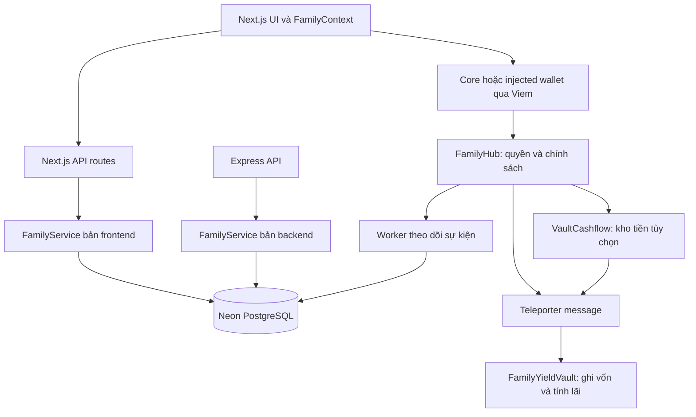

> **Historical engineering note.** This document may describe superseded plans or validation results. See the [current project status](STATUS.md) for supported behavior and deployment evidence.

# Kinetix — Báo cáo rà soát kiến trúc, bảo mật và mức độ hoàn thiện

Ngày: 04/11/2026. Mốc mã nguồn: `d6fbe4c` và working tree tại thời điểm rà soát.

## 1. Kết luận điều hành

Kinetix có mô hình sản phẩm rõ: quản lý quỹ gia đình và nhóm, phân quyền đa thế hệ, bảo hộ khoản rút lớn, thưởng việc nhà, góp vốn xoay vòng và tiết kiệm mục tiêu. Cấu trúc hũ động và ý tưởng tách quản trị khỏi kho tiền đáng giữ lại.

Tuy nhiên, mã hiện tại phù hợp với nguyên mẫu trình diễn có một số thao tác blockchain thật. Chưa có cơ sở để coi đây là hệ thống tài chính sẵn sàng nhận tiền thật. Khoảng cách lớn nhất nằm ở xác thực/phân quyền, bảo chứng tài sản, tính đúng của cross-chain và sự thống nhất giữa blockchain, database và UI.

Khuyến nghị: giữ định hướng sản phẩm và cấu trúc UI chính; thiết kế lại các ranh giới bảo mật, luồng tài sản và đồng bộ trạng thái. Không nên tiếp tục mở rộng tính năng trước khi xử lý nhóm P0.

## 2. Phạm vi và cách kiểm chứng

Đã khảo sát các lớp mã nguồn trong `contracts/`, `frontend/src/`, `backend/src/`, `scripts/`, `test/`, schema/migration, cấu hình, tài liệu và lịch sử Git. ABI frontend được đối chiếu bằng dữ liệu với artifact biên dịch. Dependencies, cache và build output không được coi là mã nghiệp vụ cần review thủ công.

Đây là code review kết hợp kiểm chứng Hardhat cục bộ, không phải chứng nhận audit độc lập. Không kiểm tra hiệu lực credential, không thử khai thác deployment công khai, không ghi vào Neon DB và không gửi giao dịch lên mạng thật. Chưa kiểm thử giao diện bằng trình duyệt hoặc đánh giá tải thực tế.

| Kiểm tra | Kết quả quan sát |
|---|---|
| `npm test -- test/Kinetix.test.ts test/SecurityHardening.test.ts` | 40 test pass |
| TypeScript root: `tsc --noEmit --incremental false` | Pass |
| TypeScript frontend với cấu hình riêng | Pass |
| `npm --prefix frontend run build` | Pass khi chạy ngoài sandbox; lần đầu bị môi trường chặn `spawn EPERM` |
| `npm run sol:lint` | 0 errors, 246 warnings |
| 4 ABI frontend so với artifacts hiện tại | Khớp |
| `auth.test.ts`, `backend.test.ts` | Đã đọc; không chạy vì phụ thuộc database và sửa dữ liệu |
| Hai blockchain, relayer, allowlist và chuyển tài sản thực tế | Chưa được kiểm chứng vận hành |

Build thành công và test pass xác nhận khả năng biên dịch cùng những hành vi đã được test; không chứng minh đầy đủ an toàn tài sản.

## 3. Tôi hiểu hệ thống đang làm gì

### 3.1. Mô hình nghiệp vụ

`User → WorkspaceMembership → Workspace → Vault → VaultMembership` là mô hình đích. Bên cạnh đó, mã còn giữ `users.familyId`, `users.role` và alias `families = workspaces` từ mô hình một gia đình cũ.

| Hũ | Ý định sản phẩm | Hiện trạng |
|---|---|---|
| SHIELD | Người thụ hưởng rút nhỏ, người bảo hộ duyệt khoản lớn | Có contract; chưa có ngân sách cộng dồn theo ngày và kiểm soát chống chia nhỏ giao dịch |
| MILESTONE | Làm nhiệm vụ, nộp bằng chứng, cha mẹ duyệt thưởng | Contract có lifecycle; luồng UI chính đang chủ yếu cập nhật DB |
| ROSCA | Góp theo kỳ, nhận theo thứ tự | Có vòng nhận và thời gian; chưa có sổ đóng góp mỗi người/mỗi kỳ, xử lý thiếu đóng, kết thúc chu kỳ hoặc phân bổ lãi đầy đủ |
| SHARED_GOAL | Khóa quỹ theo mục tiêu/thời hạn và biểu quyết | Có điều kiện ở đường tạo yêu cầu lớn, nhưng các đường chi khác chưa cùng áp dụng chính sách |

### 3.2. Kiến trúc thực tế

- Frontend dùng Next.js 14.2.3, React 18, Tailwind, Viem và Context. Không thấy Wagmi được cài hoặc sử dụng như tài liệu yêu cầu.
- API mặc định của frontend là `/api` trong Next.js. Express vẫn tồn tại với API tương tự và logic riêng.
- Hai bản schema hiện giống nhau; hai bản service đã lệch. Test backend chủ yếu chạy bản Express/service backend, không kiểm tra toàn bộ API Next.js đang phục vụ frontend.
- `FamilyHub` có cả sổ cái nội bộ lẫn chế độ ủy thác sang `VaultCashflow`, làm tăng số trạng thái phải giữ nhất quán.
- `FamilyYieldVault` tính lãi tuyến tính từ timestamp với tỷ lệ 8%/năm và cho phép compound thủ công. Không thấy adapter gọi giao thức lending/staking sinh lợi bên ngoài.
- Worker chủ yếu đọc sự kiện của một Hub, cập nhật DB theo số `vaultId`/`requestId`, chưa định danh đầy đủ theo mạng và địa chỉ hợp đồng.

## 4. Phát hiện cần xử lý

P0: chặn phát hành có tiền thật. P1: bắt buộc trước beta đáng tin cậy. P2: nâng chất lượng và khả năng bảo trì. Mức ưu tiên dưới đây là đánh giá kỹ thuật, không phải thang điểm CVSS.

### F01 — P0: Có đường đăng nhập bỏ qua PIN

`frontend/src/app/api/auth/family-login/route.ts:46,64,74` tìm user theo ID/role, có fallback lấy user đầu tiên, chỉ kiểm PIN khi client cung cấp PIN, rồi cấp JWT. Ngoài ra còn chấp nhận PIN `1234` thay cho PIN thật. Endpoint vẫn được build và có thể gọi trực tiếp dù UI không dùng nó.

Tác động: có thể cấp phiên của người khác nếu endpoint được triển khai và truy vấn DB tìm thấy user. Cần loại bỏ endpoint cũ hoặc đưa về cùng quy trình xác thực nghiêm ngặt.

### F02 — P0: API tài chính thiếu xác thực và quyền theo workspace/vault

Các route tạo/rút/duyệt hũ, nhiệm vụ và ROSCA nhận ID từ body rồi gọi service, không có guard nhất quán. `frontend/src/app/api/vaults/route.ts:181` còn cho phép PATCH trực tiếp số dư cache. `backend/src/routes/apiRoutes.ts` cũng không có middleware xác thực. Middleware frontend chủ động bỏ qua `/api`.

Tác động đã thấy từ code: sửa trạng thái tài chính và dữ liệu người khác, tạo phê duyệt giả hoặc xem dữ liệu ngoài phạm vi. Điều này không tự động đồng nghĩa có chữ ký ví để chuyển tiền on-chain, nhưng làm mất tính tin cậy của ứng dụng.

Cần xác thực mọi API riêng tư, lấy actor từ session và kiểm membership/role trên tài nguyên đích. Balance cache chỉ được cập nhật từ receipt/event được kiểm chứng.

### F03 — P0: Tự thay đổi vai trò bảo mật qua trang hồ sơ

`frontend/src/app/api/user/profile/route.ts:90` nhận `defaultRole`, rồi gán cả `users.role`. `/api/auth/me` lại đọc role mới từ DB. Tùy chọn giao diện đang sửa cả quyền nghiệp vụ. Route thêm thành viên kiểm role trong token nhưng chưa kiểm tra người gọi thuộc đúng `familyId` đích.

Cần tách `preferredView` khỏi vai trò theo workspace; quyền chỉ thay đổi qua quy trình quản trị có kiểm tra actor, đích và audit log.

### F04 — P0: Credential và JWT secret có fallback trong mã

`frontend/src/db/index.ts:5` có URL database kèm credential; README cũng có cấu hình dạng credential cụ thể. Không kiểm tra chúng còn hiệu lực. `frontend/src/lib/jwt.ts:17` dùng secret công khai nếu thiếu biến môi trường.

Cần xử lý credential đó như đã lộ: xác minh phạm vi, thay credential thật nếu còn dùng, bỏ fallback và quét lịch sử Git. JWT secret phải bắt buộc ở runtime. Không đưa giá trị bí mật vào báo cáo hay log mới.

### F05 — P0: Cross-chain mới truyền thông điệp, chưa chuyển tài sản

`contracts/FamilyHub.sol:501` và `contracts/VaultCashflow.sol:186` ghi `cChainPrincipal` và gửi message, nhưng không chuyển phần native token đó ra khỏi hợp đồng nguồn. Receiver cộng principal từ payload. Không thấy ICTT TokenHome/TokenRemote hoặc cơ chế tương đương xác minh tài sản thực nhận.

Kiểm chứng local: nạp 100 AVAX, nguồn vẫn giữ 100 AVAX, đích có 0 AVAX nhưng nhận ghi sổ principal. ICM gửi thông điệp bất đồng bộ; ICTT là ứng dụng chuyển token với cơ chế bảo chứng riêng. [Tài liệu ICM](https://build.avax.network/docs/cross-chain/icm-contracts/overview), [tài liệu ICTT](https://build.avax.network/docs/cross-chain/interchain-token-transfer/overview).

Cần thiết kế lại luồng tài sản, representation của token, xác nhận nhận tiền và trạng thái đang chuyển. Không được coi gửi message là bridge thành công.

### F06 — P0: Luồng rút có khả năng chi trả ở cả hai chuỗi

Khi thiếu đệm, nguồn gửi message WITHDRAW phần thiếu tới recipient, sau đó vẫn trả toàn bộ `amount` tại nguồn (`VaultCashflow.sol:297,302`; Hub có logic tương tự). `FamilyYieldVault.sol:318` trả phần thiếu trực tiếp tới recipient ở đích.

Kiểm chứng trong mock cùng EVM, receiver được cấp sẵn thanh khoản: request 70 AVAX với đệm 10 làm recipient nhận tổng 130 AVAX. Đây là bằng chứng lỗi mô hình thanh toán; không phải khẳng định deployment hai chain đã bị khai thác.

Cần một điểm hoàn tất giải ngân: đích trả vốn về treasury nguồn, nguồn xác nhận đã nhận đủ rồi trả recipient; hoặc thiết kế trả đích duy nhất với quy tắc rõ. Thiếu ACK/retry/reconciliation hiện khiến không thể xác nhận settlement đầy đủ.

### F07 — P0: Chính sách hũ có thể bị vượt qua

`FamilyHub.fastWithdraw` không giới hạn loại hũ; `createChore` không bắt buộc MILESTONE và không kiểm tra assignee là beneficiary. Một Guardian có thể tạo/duyệt chore trên hũ khác để chi tiền mà không đi qua quorum rút lớn.

Kiểm chứng: SHARED_GOAL có mục tiêu 100, số dư 10 và deadline tương lai vẫn rút được 1 qua fastWithdraw, sau đó thêm 1 qua chore. Phải áp dụng chính sách tại mọi đường chi, không chỉ màn hình hoặc requestLargeWithdrawal.

### F08 — P0: Compound và trả lãi không bắt buộc đủ dự trữ

`FamilyYieldVault.sol:354` tăng principal bất kể reserve; chỉ trừ reserve nếu đủ. `_handleWithdrawal` cũng chỉ trừ reserve có điều kiện. Kiểm tra tổng native balance không ngăn dùng vốn của hũ khác để trả lãi.

Kiểm chứng: hai hũ mỗi hũ nạp 100, reserve bằng 0; compound hũ 1 vẫn tăng principal. Sau khi owner rút principal đã tăng, tài sản còn lại nhỏ hơn principal của hũ 2. Đây là kiểm chứng đường owner hợp lệ, không phải quyền rút tùy ý của outsider.

Cần nguồn lợi suất thật hoặc mô hình trợ cấp minh bạch, chặn khi thiếu bảo chứng, tách principal/reserve/liabilities và kiểm tra invariant tổng tài sản. Công thức hiện là lãi đơn theo năm giữa các lần compound, không phải cam kết APY cố định tự động.

### F09 — P0: Nạp vào vault chưa tồn tại tự cấp creator cho người gửi

`FamilyHub.sol:504` tự tạo SHIELD với creator là depositor nhưng không thiết lập guardian/beneficiary đầy đủ. Người gửi biết ID có thể nạp trước để chiếm creator của ID đó. UI/DB lại tự gán ID và không luôn đọc ID từ event.

Kiểm chứng: attacker nạp nhỏ vào ID 42 chưa tồn tại; victim nạp tiếp vào cùng ID; attacker rút được 1 AVAX nhờ quyền creator. Xóa auto-init và chỉ nhận tiền vào vault đã tạo, đúng cấu hình, đúng deployment.

### F10 — P1: Sai cấu hình mạng và sender của message

- `frontend/src/contracts/config.ts:28` gán Family L1 bằng 43114; đây là chain ID của Avalanche C-Chain mainnet. Hardhat mặc định Family L1 là 99999. [Mạng chính thức](https://build.avax.network/docs/primary-network).
- Script deploy/wiring tự hash chuỗi hoặc EVM chain ID để tạo blockchain ID. ICM cần blockchain ID thực trên P-Chain, không phải ID tự suy ra. [Phân biệt blockchain ID](https://docs.avax.network/academy/avalanche-l1/interchain-messaging/03-icm-protocol/03-sending-a-message).
- Khi bật Cashflow, sender thực là Cashflow nhưng YieldVault/script vẫn cấu hình Hub. Mock bắt lỗi và bỏ qua. Kiểm chứng local: deposit thành công ở nguồn nhưng remote principal không tăng trong đường Cashflow.
- Không thấy genesis, quản trị validator, cấu hình precompile hoặc relayer trong repo. Mapping `isAllowlisted` không tương đương Transaction AllowList precompile; hiện cũng không được dùng làm guard nhất quán ở contract. [Precompile chính thức](https://build.avax.network/academy/avalanche-l1/access-restriction/02-genesis-activation/01-permissioning-precompiles).

### F11 — P1: UI báo thành công trước hoặc sau khi giao dịch thất bại

`FamilyContext.tsx:688,904,971` bắt lỗi on-chain rồi tiếp tục cập nhật DB/UI. ID yêu cầu rút lấy ngẫu nhiên ở dòng 957; ID hũ lấy từ số lượng hũ đang hiển thị ở dòng 628. Deposit đợi receipt nhưng không kiểm `receipt.status`, và timeout vẫn đi tiếp.

`GuardianView.tsx:42` gọi approve mà không truyền `onchainRequestId`; điều kiện trong Context bỏ qua writeContract rồi API vẫn tăng approvals. `FamilyService.approveWithdrawal` bỏ qua danh tính guardian và tăng bộ đếm mỗi lần gọi. UI suy ra tên người đã ký từ thứ tự danh sách thay vì từng chữ ký thật.

Cần transaction state machine, kiểm receipt thành công, decode event để lấy ID và định danh đúng người ký; mọi thất bại phải hiện đúng trạng thái.

### F12 — P1: Dữ liệu mô phỏng trộn với dữ liệu thật

Đăng ký/workspace tự tạo cached balance khác 0 dù chưa có nạp tiền; nhiều workspace dùng lại onchain ID 0/1/2. GET workspace có thể tự gán người dùng toàn hệ thống vào gia đình và tạo hũ có số dư mẫu. Context khởi tạo ví đã kết nối, tiền, thông báo và lịch sử mặc định.

`addMemberToFamily` tại `FamilyContext.tsx:1179` chỉ return success, không gửi request. VideoCallModal dùng ảnh và timer nhưng hiển thị xác minh danh tính/E2EE. TransactionLedgerModal có hash gán cứng và coi cả APPROVED là CONFIRMED. SettingsContext tạo latency L1 ngẫu nhiên. KidsView cộng sẵn 0.08 vào tiền đã kiếm; ảnh bằng chứng là ảnh preset.

Tách demo fixtures vào môi trường riêng; production phải có empty/error/loading state trung thực. Không dùng nhãn xác minh, đã nhận tiền hoặc đã kết nối nếu chưa có bằng chứng.

### F13 — P1: Tenant và định danh on-chain chưa thống nhất

DB dùng `onchainVaultId` dạng integer không có khóa unique theo `(chainId, contractAddress, vaultId)`. Worker thường lấy bản ghi đầu tiên theo ID và gán vault mới vào workspace đầu tiên. Các membership thiếu unique composite; wallet unique có thể khác nhau do chữ hoa/thường. Một số luồng chỉ dùng `users.familyId` thay vì membership nhiều workspace.

Cần registry deployment, ràng buộc tenant, wallet normalization, unique memberships và index phục vụ query. Không tự động gán user lạ vào gia đình để chữa dữ liệu thiếu.

### F14 — P1: Cache có thể cộng trùng và worker không phục hồi đầy đủ

Deposit được cộng qua PATCH từ client và qua event worker; cả hai đều đọc-cộng-ghi. Không có khóa event `(chainId, txHash, logIndex)`, checkpoint, backfill hay chiến lược reorg. Worker khai báo một số event nhưng không đăng ký handler cho fast withdrawal/chore claim; chưa đồng bộ đủ ROSCA, recovery và chuỗi đích. Sự kiện approval/execution có thể được xử lý khác thứ tự.

DB nên là read model có thể tái tạo. Indexer phải xử lý mỗi event đúng một lần về tác dụng, chạy lại an toàn và có đối soát với chain. Notification hiện chưa có kênh push/poll trong luồng chính; chưa đủ cơ sở gọi là realtime end-to-end.

### F15 — P1: SIWE và quản lý phiên chưa chặt

Verify chỉ tách address/nonce bằng regex và kiểm chữ ký. Nonce có thể thiếu, không tìm thấy hoặc truy vấn lỗi mà vẫn đi tiếp; select rồi delete không nguyên tử. Register/join chưa dùng chung kiểm tra nonce, domain, URI, thời gian và chain. PIN được lưu so sánh dạng rõ; không thấy rate limit/lockout. Member-login chấp nhận bất kỳ PIN không rỗng nếu account chưa có PIN.

Theo [ERC-4361](https://eips.ethereum.org/EIPS/eip-4361), cần parse đúng chuẩn và kiểm các trường kỳ vọng bên cạnh signature. Áp dụng nonce dùng một lần nguyên tử, session revocation và xác thực tăng cường khi đổi PIN/quyền.

### F16 — P1: Chưa có embedded wallet/passkey có thể ký giao dịch

`frontend/src/app/api/families/[id]/members/route.ts:97` sinh private key rồi chỉ lưu địa chỉ. Không thấy lưu khóa an toàn, liên kết WebAuthn credential, signer hoặc cơ chế account abstraction tương ứng. Nhãn `PASSKEY_EMBEDDED` trong DB không tạo ra các khả năng đó.

Phải chốt mô hình sở hữu khóa, khôi phục và ký trước khi cho địa chỉ này nhận tiền. PIN đăng nhập ứng dụng không thay thế quyền ký blockchain.

### F17 — P1: Social recovery và quyền quản trị chưa hoàn chỉnh

Recovery đổi mapping nhưng không đổi phần tử trong `guardians[]`/`beneficiaries[]`, task assignee hoặc recipient của request cũ. ROSCA dùng mảng beneficiaries nên có thể tiếp tục trả về ví cũ. Kiểm chứng local xác nhận mapping mới đúng nhưng getter danh sách vẫn giữ ví cũ.

Chưa có expiry/cancel/delay của recovery và ngăn guardian trùng. `familyAdmin` có ngoại lệ quyền toàn Hub; owner của Cashflow được gọi thẳng executeWithdrawal để bỏ qua policy. Đây là quyền tập trung cần công khai và thiết kế lại nếu định vị non-custodial.

48 giờ hiện là hạn hết hiệu lực yêu cầu, không phải thời gian bắt buộc chờ trước giải ngân. Cần phân biệt expiry với timelock và bổ sung ngân sách SHIELD cộng dồn để tránh chia nhỏ khoản rút.

### F18 — P1/P2: Migrations, precision, dependency và kiểm thử

- Migration/snapshot đầu thiếu `family_code`, `admin_wallet` và 6 cột ROSCA/goal trong schema hiện tại; chúng nằm trong script alter rời, không thuộc journal. Cài mới qua migration chuẩn chưa phản ánh đầy đủ schema.
- `seed.ts` TRUNCATE toàn bộ DB; `apply-migration.ts` DROP bảng, bỏ qua lỗi rồi có thể báo thành công. Cần tách công cụ reset dev và bắt buộc bảo vệ môi trường.
- Tiền được đổi sang JS Number và `.toFixed(6)`, trong khi native asset có 18 decimals. Lưu đơn vị nhỏ nhất bằng `numeric(78,0)` và chuỗi bigint ở API; chỉ làm tròn lúc hiển thị.
- Drizzle/Neon/Viem khác phiên bản giữa root/backend và frontend; không thấy workspace package chuẩn hoặc CI. Next.js 14 đã nằm ngoài danh sách được hỗ trợ hiện tại. Nâng lên bản được hỗ trợ với migration có kiểm thử, không chỉ thay số version. [Chính sách hỗ trợ](https://nextjs.org/support-policy).
- Test còn khẳng định hành vi không an toàn là đúng: tăng approvals không cần guardian, gắn EXECUTED không cần receipt, compound không đủ reserve. Mock nuốt lỗi receiver khiến test xanh che lỗi tích hợp.
- Thiếu test HTTP cho API Next, phân quyền chéo tenant, receipt revert, indexer replay/restart, hai chain thật, invariant/fuzz và E2E.

## 5. Phần nên giữ và phần nên làm lại

| Thành phần | Quyết định đề xuất |
|---|---|
| Ý tưởng đa thế hệ và 4 rule templates | Giữ; triển khai SHIELD + MILESTONE trước để kiểm soát phạm vi |
| Phân tách Policy/Treasury | Giữ nguyên tắc; chỉ có một sổ cái tài chính có thẩm quyền |
| Next.js, TypeScript, Viem, PostgreSQL | Giữ nền tảng; cập nhật bản hỗ trợ và chuẩn hóa package dùng chung |
| UI theo vai trò, ngôn ngữ và trợ năng | Giữ định hướng; thay dữ liệu mô phỏng, trạng thái giả và khung điện thoại trong trải nghiệm thực |
| Auth/authorization/tenant | Thiết kế lại tập trung, deny-by-default |
| Bridge và settlement | Thiết kế lại; dùng ICTT hoặc giải pháp tương đương có tài sản bảo chứng và kiểm thử hai chain |
| Yield | Thiết kế lại quanh tài sản thật và nguồn lợi suất; nếu dùng trợ cấp thì ghi rõ và giới hạn bởi reserve |
| FamilyContext | Tách theo auth, workspace, vault queries và giao dịch; dùng một lớp Web3 chung |
| Hai FamilyService và schema | Hợp nhất vào package server/domain dùng chung; giảm API công khai trùng lặp |
| Indexer và financial cache | Xây lại thành pipeline có checkpoint, event log, idempotency và reconciliation |
| Tests và deployment scripts | Giữ case hữu ích; sửa mock, bổ sung invariant và release gates |

## 6. Kiến trúc nâng cấp đề xuất

Giữ mục tiêu Family L1 + C-Chain nhưng triển khai luồng tiền tối thiểu đúng trước. Với quy mô hiện tại, Next.js BFF là API tương tác chính; worker là tiến trình riêng; domain/schema/deployment registry nằm trong package dùng chung. Chỉ giữ Express công khai nếu có nhu cầu client/API độc lập cụ thể.

Blockchain quyết định quyền chi, tài sản và kết quả giao dịch. DB lưu metadata riêng tư, membership ứng dụng và bản chiếu sự kiện đã kiểm chứng. Client gửi ý định và ký giao dịch; không được tự xác nhận balance hoặc settlement.

Luồng chuẩn: `simulate → ký → broadcast → receipt thành công → decode event → index → đối soát → UI xác nhận`. Cross-chain bổ sung `pending transfer → tài sản thực nhận → ACK → settlement`; timeout/retry không được giải ngân trùng.

Các bất biến cần được test: chi đúng policy; tổng nghĩa vụ được bảo chứng bằng tài sản hợp lệ; mỗi request trả đúng một lần; dự trữ không âm; một event chỉ tác động một lần; tenant không truy cập chéo; signer khôi phục không giữ quyền của địa chỉ cũ.

Các kế hoạch phiên cũ đã được gộp trước đó; tài liệu kế hoạch đã được dọn sau khi không còn phiên triển khai liên quan hoạt động. Báo cáo này giữ làm bằng chứng rà soát lịch sử.
