# Thiết kế lại tạo hũ và tích hợp nghiệp vụ–contract

Ngày lập/cập nhật: 05/11/2026. Trạng thái: **đã triển khai và kiểm thử cục bộ; chưa nghiệm thu Core/Fuji thực**.
Phạm vi: UI tạo hũ, thành viên/quyền, ký Core, receipt, đăng ký DB, indexer và hành
động sau tạo cho SHIELD, MILESTONE, ROSCA, SHARED_GOAL.
Tiếp nối [hành trình lần đầu sử dụng](FIRST_USE_PLAN.md), không viết lại auth hoặc
thay policy tài sản chỉ để làm giao diện.

## 1. Kết quả cần đạt

Người dùng hiểu mình đang tạo loại hũ nào, ai được nhận/duyệt, tiền được sử dụng
theo quy tắc gì và giao dịch đang ở bước nào. Sau tạo, hũ có mapping/receipt đúng
workspace, xuất hiện trong danh sách và có đường đi tới nạp tiền/nhiệm vụ/đóng góp/
quyết toán tương ứng. Không kết thúc ở thông báo thành công rồi đóng modal.

Giữ T1 AVAX/Fuji 43113, `bufferRatioBps=10000`, vốn ở cùng chain. Manifest hiện vẫn
`enabled=false`, chưa có deployment receipt. Bản nháp có thể làm trước; chỉ mở ký
khi deployment, wallet, role và policy được xác minh. Không quảng bá USDC, 8% APY,
bridge, gasless hoặc tự động hoàn tiền khi các chức năng này chưa được bật.

## 2. Hiện trạng và khoảng trống

Các nhận xét dưới đây là đối chiếu source, không phải kết quả khai thác hoặc E2E mới.

| ID | Ưu tiên | Quan sát trong mã | Hướng hoàn thiện |
|---|---|---|---|
| V01 | P1 | `CreateVaultModal` có 3 bước; bước 2 chủ yếu là thông tin T1 cố định, bước 3 gộp thành viên/quorum/policy | Chia theo quyết định người dùng; bỏ bước cấu hình tỷ lệ không còn được phép thay đổi |
| V02 | P1 | Không có màn tổng kết cấu hình, người nhận, quorum và phí trước ký | Thêm review riêng; từ review quay lại sửa không mất draft |
| V03 | P1 | `FamilyContext.createCustomVault` trả success/error; modal đóng khi success, không thể hiện rõ broadcast/finality/sync | Trạng thái giao dịch riêng, giữ hash, recovery/retry theo giao dịch đã gửi |
| V04 | P1 | Form nhận `description`, nhưng args/sync hiện chỉ truyền name/policy + workspace/txHash; POST `/vaults` không lưu description | Lưu metadata off-chain có scope và idempotency; chỉ dữ liệu contract là authority tài chính |
| V05 | P1 | Candidates trả `allowed` boolean; modal chỉ giữ mảng địa chỉ và danh sách form lấy từ `members` khác | Một DTO candidates có tên/role/link/allowlist/reason/provenance; không nhầm lỗi RPC với bị thu quyền |
| V06 | P0 tích hợp | API đăng ký tạo vaultMembers cho các ví nhận diện trong workspace; chưa thấy assertion rằng toàn bộ guardian/beneficiary on-chain đều thuộc workspace hợp lệ | Chốt policy app, kiểm toàn bộ coverage ở preflight và receipt registration; không tự tạo membership cho ví lạ |
| V07 | P1 | ROSCA dùng mảng beneficiary theo thứ tự chọn; contract chi cho `beneficiaries[round]` | Hiển thị và cho sắp xếp thứ tự rõ ràng, dùng cùng một thứ tự ở review/calldata/DB/read model |
| V08 | P1 | Goal dùng input date rồi `new Date(date)` thành epoch; người dùng chưa thấy múi giờ/giờ hết hạn | Dùng ngày + giờ + múi giờ rõ, kiểm theo block time và hiển thị cùng timestamp ở mọi bước |
| V09 | P1 | Có entry tại AppShell, GuardianView và `/start`; guard/feedback ở các điểm vào chưa đồng nhất | Một flow/controller và một host; cùng eligibility/preflight, tránh mở modal hai lớp |
| V10 | P1 | `useFamilyHub.createCustomVault` là đường tạo khác, chỉ gọi hàm cơ bản và không có reconciliation intent như FamilyContext | Hợp nhất đường ghi; bỏ/deprecate wrapper tạo cũ sau kiểm usages, không tạo transaction engine mới |
| V11 | P1 | API đọc `getVault` latest để so receipt, trong khi nghiệp vụ đang dần dùng finalized snapshot | Tách bằng chứng cấu hình tại receipt block khỏi quyền/trạng thái live; lưu provenance nhất quán |
| V12 | P1 | Contract chặn assignee là Guardian lúc `createChore`, nhưng không cấm hai danh sách giao nhau lúc tạo MILESTONE | Chặn cấu hình không dùng được ngay từ UI/API; quyết định riêng việc đồng bộ ràng buộc ở Solidity |
| V13 | P1 | Metadata bản nháp chưa gắn trước ký với workspace/intent; registration hiện nhận workspace + txHash | Ràng buộc draft–actor–workspace–deployment–calldata, tránh đăng ký nhầm khi nhiều tab/gia đình |

Tận dụng phần đã có: manifest verifier, transaction-context, simulation, receipt
verifier, `financial_operations`, retry/finality policy, unique mapping/event và worker
projection. Không thay các guard bằng boolean từ client hoặc bỏ 409 để tạo hũ cho được.

## 3. Giao diện đề xuất

### Kiểu trình bày và điểm vào

Một **wizard toàn màn hình**, desktop có form chính + cột tóm tắt, mobile một cột
và thanh hành động cuối màn hình. Dùng cùng ngôn ngữ thiết kế với `/start`: nền sáng,
thẻ rõ ràng, điểm nhấn đỏ, chữ dễ đọc; thay các template card chỉ-click bằng nút có
keyboard/focus/aria. Không yêu cầu người dùng hiểu tuple, BPS hoặc calldata.

Một `CreateVaultFlow` tái sử dụng cho tất cả entry. Từ dashboard có thể dùng route
`/dashboard/vaults/new?workspace=<id>`; từ `/start` mở cùng flow ở dialog toàn màn hình
để không bị gate quay lại onboarding. Không mount GuardianView ẩn để sử dụng modal.

Nếu thêm route: tạo route tĩnh ưu tiên hơn catch-all, cập nhật whitelist/guard hiện
đang chỉ nhận guardian/elderly/kids/rosca. Không để `/start` đang IN_PROGRESS điều
hướng sang route dashboard rồi bị middleware trả về `/start` thành vòng lặp.

### Các bước

| Bước | Người dùng quyết định | Nội dung hiển thị |
|---|---|---|
| 1 — Chọn mục đích | Bảo vệ người thân / thưởng việc nhà / góp xoay vòng / mục tiêu chung | Ví dụ phù hợp, ai dùng được, cách rút, điều kiện và giới hạn thật; tên/mô tả hũ |
| 2 — Chọn người | Người thụ hưởng, người ký duyệt, thứ tự nhận nếu ROSCA | Thẻ thành viên, vai trò app tách khỏi vai trò hũ; trạng thái chưa kích hoạt/chưa linked/chờ cấp quyền/chưa xác minh và cách xử lý |
| 3 — Đặt quy tắc | Hạn mức, M/N, mục tiêu/hạn dùng hoặc khoản góp/kỳ | Chỉ hiện trường của template đang chọn, validation tại trường; giải thích policy bằng tiếng Việt và preview cụ thể |
| 4 — Kiểm tra và ký | Xác nhận cấu hình bất biến rồi mở Core | Đúng gia đình, ví tạo, chain, asset, thành viên, quorum, thứ tự, phí ước tính có thời điểm kiểm tra; chi tiết kỹ thuật thu gọn |
| Sau ký — Theo dõi | Chờ xác nhận/đồng bộ hoặc tiếp tục xử lý | Hash/explorer trong details, receipt/finality/sync phân biệt; CTA theo loại hũ sau khi đã đăng ký thành công |

Người tạo chỉ ký **một giao dịch tạo hũ** trong flow T1 hiện tại. M/N là quyền duyệt
chi tiền/thưởng sau này, không phải yêu cầu M/N cùng ký giao dịch tạo hũ. Phí mạng
khác với tiền nạp: tạo hũ có số dư ban đầu 0; nạp tiền là giao dịch riêng sau đăng ký.

Trước broadcast có Lưu bản nháp/Quay lại/Đóng. Sau broadcast, Đóng nghĩa là tiếp tục
theo dõi nền, không phải hủy giao dịch blockchain. Không tự resend khi timeout.

## 4. Cấu hình từng loại hũ và đường sử dụng sau tạo

| Hũ | Form/review phải thể hiện | Liên kết contract | CTA sau tạo |
|---|---|---|---|
| SHIELD | Beneficiary, Guardian, M/N, hạn mức một lần; ngân sách rút nhanh ngày dùng chung = 2 × hạn mức, ngày UTC theo block | `createCustomVault`, `depositToVault`, `fastWithdraw`, `requestLargeWithdrawal`, `approveWithdrawal`/`executeWithdrawalWithSignatures` | Nạp tiền → xem hũ hỗ trợ; đủ quyền thì tạo/rà soát yêu cầu rút |
| MILESTONE | Người nhận thưởng khác Guardian hũ; số chữ ký duyệt thưởng; fast limit = 0 | `createCustomVault`, `depositToVault`, `createChore`, `claimChoreCompleted`, `verifyAndRewardChore`, `cancelChore` | Nạp tiền → giao nhiệm vụ → nộp bằng chứng → duyệt đủ M/N; hủy giải phóng reserve |
| ROSCA | Khoản góp cố định, chu kỳ, thứ tự nhận có số thứ tự; chi đủ khi mọi người đã góp; một chu kỳ hữu hạn | `createAdvancedVault`, `contributeRoscaRound`, `payoutRoscaRound` | Xem kỳ/thành viên → góp đúng khoản; không mở modal donation dành cho hũ thường |
| SHARED_GOAL | Target > 0, deadline tương lai, người thụ hưởng và M/N; mỗi lần chi kiểm lại target hoặc deadline | `createAdvancedVault`, `depositToVault`, `requestLargeWithdrawal`, `approveWithdrawal`/`executeWithdrawalWithSignatures` | Nạp tiền → theo dõi mục tiêu → yêu cầu quyết toán khi đủ điều kiện |

Chi tiết cần giữ đúng:

- Hạn mức SHIELD = 0 có thể dùng để tắt rút nhanh; không hiển thị thành không giới hạn.
  Chống overflow theo `fastWithdrawLimit <= uint256.max / 2` và parse tiền chính xác.
- ROSCA: deadline/kỳ sau dựa trên timestamp chi kỳ trước, không phải lịch tháng cố định.
  Thời điểm kỳ đầu tính từ block tạo hũ. T1 chưa có exit/default/cancel/refund; công bố
  giới hạn trước khi ký, không dựng nút hoàn tiền chỉ sửa DB.
- Goal: chi một phần trước hạn có thể làm phần tiếp theo phải chờ nạp thêm hoặc hết hạn.
  Đạt target một lần không đồng nghĩa mở khóa vĩnh viễn. Không hứa tự hoàn theo người góp.
- Quorum cần địa chỉ Guardian khác nhau, 1 ≤ M ≤ N ≤ 32; beneficiary 1…64 địa chỉ khác
  nhau. Creator/Admin workspace không tự có phiếu hoặc quyền nhận tiền.
- Contract không biết tuổi hay membership ứng dụng. Rule eligibility theo app không
  được mô tả như bảo đảm tuổi/quyền toàn cục on-chain. Vai trò Guardian + Beneficiary
  có thể đồng thời ở các policy cho phép; DTO phải hiển thị cả hai, không suy từ một
  nhãn `vaultRole` duy nhất trong DB.
- Tên, số tiền, date/time có validation thống nhất; số tiền giữ string/bigint xuyên
  suốt, không dùng Number hoặc tỷ giá cố định cho dữ liệu ký.

## 5. Luồng tích hợp đích

```mermaid
flowchart LR
  A[Draft theo user/workspace] --> B[Chuẩn hóa và validate policy]
  B --> C[Preflight server + deployment + members]
  C --> D[Review cùng calldata]
  D --> E[Recheck session/account/chain + simulate]
  E --> F[Core ký và broadcast]
  F --> G[Lưu hash trong operation journal]
  G --> H[Receipt thành công và finalized]
  H --> I[Decode VaultCreated và đối chiếu cấu hình]
  I --> J[Đăng ký mapping + metadata + vaultMembers]
  J --> K[Worker/read model và refresh capabilities]
  K --> L[Chi tiết hũ + hành động kế tiếp]
```

### Draft và validation

- Dùng typed discriminated union theo bốn rule; một builder sinh args cho review,
  simulation và write, không lặp bộ quy tắc ở modal/context/hook riêng.
- Đề xuất `vault_creation_drafts` để giữ metadata và resume khác thiết bị: user,
  workspace, policy version, normalized config, description, revision, thời hạn
  preflight và reference operation. Đây là schema đề xuất, chưa tạo migration.
- Draft có thể lưu khi deployment chưa mở, nhưng không có quote gas giả hoặc trạng
  thái đủ quyền giả. Khi đổi workspace không mang danh sách ví cũ sang hũ mới.
- Mô tả là metadata ứng dụng, không nhét vào event/contract bằng suy đoán. Nếu metadata
  lỗi sau khi chain đã tạo hũ, báo chờ đồng bộ và cho retry, không ký tạo lại.
- Preflight nhận member IDs, server tự tra verified wallet/active membership, kiểm
  app role, allowlist, pause, Hub/chain/version. Trả `allowed/blocked/unknown`, reason
  và `checkedAt/asOfBlock`; không nhận cờ đủ quyền từ client.

### Transaction và receipt

- Tạo intent gắn draft–actor–workspace–deployment và hash của cấu hình/calldata chuẩn
  hóa trước ký. Cùng draft không broadcast hai lần; draft khác có operation riêng.
- Reuse wallet adapter và `financial_operations`; mở rộng typed result để UI biết
  `awaiting_signature`, `broadcast`, `receipt_pending`, `finality_pending`,
  `sync_pending`, `completed`, `reverted`, `needs_review` và `rejected_before_send`.
- Recheck sau mọi prompt: session còn hợp lệ, đúng tài khoản, mạng, workspace,
  membership và policy. Intent hết hạn hoặc dữ liệu đổi thì review lại trước ký.
- ID lấy từ `VaultCreated`, không dự đoán `vaultCounter + 1`. API xác minh signer,
  destination, calldata/rule/config và receipt tại block phù hợp; live permissions
  được kiểm riêng để không trộn ảnh chụp latest với bằng chứng tạo.
- Đăng ký một lần theo chain + Hub + vaultId và event evidence. Kiểm mọi ví trong
  arrays được phép trong workspace, không chỉ insert những người vô tình match.
  Hũ external/không đủ coverage chuyển review/quarantine, không tự cấp membership.
- Nếu mất response sau broadcast: khôi phục bằng journal/hash và retry sync. Cho
  nhập hash để đối soát nếu cần; nhiều intent giống nhau không được tự chọn giao dịch
  đầu tiên. Không hứa server tìm lại được hash chưa từng được lưu chỉ nhờ tên hũ.
- Hỗ trợ receipt import/mapping cũ bằng policy rõ; không khóa mất bằng chứng của hũ
  đã tồn tại. Draft không phải bằng chứng tiền hoặc quyền contract.

### Sau đăng ký

- Chọn hũ vừa tạo bằng DB UUID, refresh danh sách/capabilities/provenance, số dư 0.
- Dashboard đi tới chi tiết hũ đúng workspace; `/start` trở lại đúng bước readiness,
  không mất progress hoặc bị middleware đẩy sang gia đình khác.
- SHIELD/goal/MILESTONE mở nạp đúng hũ; ROSCA mở đóng góp đúng kỳ. MILESTONE chưa
  có vốn phải nạp trước khi reserve task; không tạo task thưởng vượt tiền khả dụng.
- Chỉ hiển thị action được giao của app + live contract cho phép. Reviewer/recipient
  của hũ vừa tạo xuất hiện đúng portal, không tự có quyền quản lý workspace.

## 6. Phạm vi smart contract

| Thành phần | Xử lý trong đợt này |
|---|---|
| `FamilyHub` | Đối chiếu invariant tạo hũ, rule params, duplicate/zero/allowlist/quorum/pause; quyết định có reject MILESTONE overlap ngay ở create hay giữ policy app |
| `VaultCashflow` | Xác minh tạo ledger đúng ID/controller và số dư 0; không đổi nơi giữ vốn hoặc thêm đường chi bypass Hub |
| ABI/manifest | Một nguồn ABI; nếu đổi Solidity/semantics thì compile/export/version/redeploy candidate và verify riêng, không dùng địa chỉ cũ như đã upgrade |
| Forwarder | Giữ trusted-forwarder verifier hiện có; flow mặc định T1 ký Core trực tiếp, không bật relayer/tài trợ phí |
| YieldVault/ICM/ERC20 | Ngoài scope; không deploy hoặc bật do thay giao diện tạo hũ |

Không bắt buộc redeploy chỉ vì redesign UI. Mọi thay đổi Solidity phải được đặc tả,
regression/invariant đạt trước nối write UI; hũ cũ giữ policy cũ, không sửa hồi tố
bằng cập nhật DB. Việc giới hạn workspace phải được API kiểm vì contract T1 chưa
có định danh workspace ứng dụng.

## 7. Các quyết định đề xuất để chốt trước triển khai

1. Giữ bốn policy T1; SHIELD/MILESTONE là đường ưu tiên. ROSCA hiển thị giới hạn thử
   nghiệm rõ trước ký; nếu chưa chấp nhận giới hạn thì khóa tạo nghĩa vụ mới bằng
   feature gate đồng nhất, không cắt đường xử lý hũ đã có vốn.
2. Cấu hình tạo hũ tiếp tục bất biến ngoài recovery đang hỗ trợ. Đổi quorum/thêm
   thành viên là backlog governance riêng; không làm nút Edit policy chỉ sửa DB.
3. Creator được lựa chọn làm Guardian nếu hợp lệ, không mặc định có quyền chỉ vì
   là Admin. Không ép M/N giả nếu gia đình chưa có đủ signer; giải thích đúng 1/1.
4. MILESTONE chặn Guardian đồng thời là assignee/beneficiary trong flow tạo của app;
   thay đổi tương ứng ở contract là quyết định có version/redeploy riêng.
5. Tạo và nạp là hai giao dịch; không gộp thành một UX báo đã có tiền trước khi receipt
   nạp thành công. Metadata/draft lưu off-chain có quyền và thời hạn riêng.

## 8. Trình tự thực thi

| Đợt | Công việc | Đầu ra nghiệm thu |
|---|---|---|
| A | Wireframe, policy matrix, typed config/validation, route/entry matrix | Bốn rule có form/review/permission/error/CTA tương ứng; xác nhận những thay đổi Solidity thực sự cần |
| B | Draft/preflight/candidates/receipt coverage và regression contract nếu đổi | Không chọn ví không đủ quyền; sai tenant/chain/calldata bị chặn; đủ backend/contract test trước UI write |
| C | Wizard, member picker, ROSCA reorder, rule editors, review, accessibility | Mobile/desktop/keyboard dùng được; draft không mất khi quay lại; không hiển thị field giả hoặc khoản tiền sai |
| D | Transaction lifecycle, journal/recovery, metadata, đăng ký idempotent | Hủy ký/revert/timeout phân biệt; không tạo trùng; receipt thành công nhưng API lỗi có đường retry |
| E | Chi tiết hũ và liên kết nạp/task/góp/quyết toán; nối `/start`/dashboard | Hũ mới dùng được đúng policy và scope, người nhận/Guardian thấy đúng dữ liệu/khả năng |
| F | PostgreSQL + local EVM, build/typecheck, browser/Core và staging | Evidence rõ; deployment thực chỉ enable sau verify; không lấy mock receipt làm Fuji acceptance |

Ước lượng ban đầu: 6–9 ngày công cho UI và tích hợp nhờ nền tảng hiện có; thêm 2–4
ngày nếu quyết định sửa Solidity/ABI và quy trình deployment tương ứng. QA Core/mobile/
Fuji phụ thuộc môi trường và signer, không gộp vào lời hứa đã nghiệm thu cục bộ.

## 9. Ma trận nghiệm thu bắt buộc

- Mỗi template tạo thành công trên local EVM → register DB → mở đúng hũ → hành động
  tiếp theo thực hiện được; không chỉ render form hoặc chỉ compile contract.
- Sai session, user chưa activate, Guardian không management flag, Admin không là
  Guardian hũ, thành viên bị khóa và tenant khác: quyền phân biệt đúng tại từng API.
- Chưa có deployment/Hub chưa nối, RPC lỗi, wrong Core/chain, thiếu gas, allowlist đổi
  trong lúc form mở: status/reason đúng, không gọi `write` khi preflight không đạt.
- 1 wei, 18 decimals, 19 decimals, số âm/0, exponent, uint256/2 boundary; quorum 0,
  M>N, duplicate/zero wallets, 32/64 limits và MILESTONE overlap.
- Goal deadline UTC/local/DST theo timezone được chọn, hết hạn khi đang review;
  target/deadline tại receipt đúng với cấu hình đã review.
- ROSCA đổi thứ tự nhận bằng chuột/keyboard, đúng khoản góp và thời điểm kỳ đầu;
  thiếu khoản/hết chu kỳ/recovery không hiển thị chi trả giả hoặc tự đổi người nhận.
- Signature rejected, revert, receipt pending/finality pending, API down sau mined,
  restart worker, reload/mất localStorage và nhiều tab: theo dõi hash cũ, không resend.
- Hai người cùng tạo, hai draft cùng tên, một người có hai workspace, receipt import
  và API replay: không nhầm ID hoặc ghi một hũ vào hai gia đình; metadata không lẫn scope.
- Một ví có nhiều vai trò hợp lệ, actor/beneficiary ngoài roster, linked wallet đổi
  sau recovery: không suy quyền từ tên/DB role cũ hoặc auto-enroll địa chỉ trong event.
- Mobile 360px, focus trap/return focus nếu dialog, ESC trước/sau broadcast, screen
  reader; trạng thái và lỗi không chỉ phân biệt bằng màu.

## 10. Trạng thái và bước tiếp theo

- [x] Rà soát form, entry points, context/hook, candidates API, receipt registration,
  operations/projection, contract create/payout policy và tài liệu deployment.
- [x] Lập kế hoạch UI + nghiệp vụ + contract, các giới hạn và tiêu chí nghiệm thu.
- [x] Chốt policy mục 7: giữ T1, chặn MILESTONE overlap trong app, không sửa Solidity.
- [x] Triển khai typed config, bản nháp/API/preflight và wizard bốn bước.
- [x] Nối journal/receipt/metadata/recovery và hành động sau tạo.
- [x] PostgreSQL riêng + local EVM, kiểm thử trạng thái component, typecheck/build.
- [ ] Nghiệm thu trình duyệt thật 360px/keyboard/screen reader.
- [ ] Nghiệm thu Core/Fuji thực với deployment đã xác minh và ví ký của người dùng.

### Kết quả triển khai

- `shared/vaultCreation.ts` là nguồn chung cho cấu hình, kiểm tra precision, quorum,
  deadline, giới hạn lưu trữ và ABI call. Không chuyển số tiền qua JavaScript Number.
- `VaultCreationProvider` là một host chung cho AppShell, GuardianView và `/start`.
  Wizard dùng native dialog toàn màn hình, CSS riêng; có lưu khi đóng, mở lại bản
  nháp, chuyển sang quản lý thành viên rồi quay lại đúng draft. Không mở hai dialog
  của flow đồng thời. Chọn deadline bằng ngày/giờ thiết bị và lưu instant ISO có timezone.
- Candidates trả trạng thái ALLOWED/DENIED/UNKNOWN, vẫn đọc được khi manifest disabled.
  Preflight kiểm active membership, ví xác minh, app role, Hub/network allowlist,
  pause, block finalized, calldata và phí ước tính; quote hết hạn sau 5 phút.
- Claim lưu attempt theo draft ở server, có khóa transaction để hai tab không cùng
  mở ký cho một draft. Calldata được so lại ngay trước Core. Chỉ giải phóng khi SDK
  trả user rejection 4001 hoặc đã biết chắc chưa mở ký do intent thay đổi. Lỗi mất
  kết nối không rõ kết quả giữ trạng thái cần đối soát, không tự gửi lại.
- Broadcast lưu hash trước khi đợi receipt; journal giữ draft ID để khôi phục khi
  mất localStorage. Có nhập hash từ Core và đối soát giao dịch thực. Retry đồng bộ
  không phát lại giao dịch. Thành công chỉ sau khi API xác minh receipt và đăng ký hũ.
- Registration đọc cấu hình tại receipt block, kiểm toàn bộ roster/Guardian coverage
  và giới hạn numeric; lưu mô tả từ draft đã gắn actor/workspace/deployment/calldata.
  Replay trả cùng vault và metadata. Receipt import cũ vẫn được hỗ trợ nhưng phải
  qua coverage; không auto-enroll ví ngoài gia đình.
- Sau tạo có nạp tiền riêng; hũ nhiệm vụ có đường từ nạp thành công sang giao việc.
  Form nhiệm vụ lọc đúng beneficiary khác Guardian theo trạng thái chain, kiểm quyền
  và phần thưởng trong số dư khả dụng. Chọn hũ vừa tạo đồng bộ sang panel nghiệp vụ;
  ROSCA tiếp tục bằng góp đúng khoản kỳ đầu ở panel này. Từ `/start`, đóng flow để
  tiếp tục checklist; gate onboarding không bị bỏ qua.
- Bỏ wrapper tạo hũ cũ trong `useFamilyHub`; không thay transaction engine hoặc ABI.

### Kiểm chứng và vận hành

| Kiểm tra | Kết quả |
|---|---|
| `npm test` | 178 pass; 20 ca PostgreSQL được chạy riêng ở dòng sau |
| `npm run test:auth:local` | 125 pass, gồm 20 ca PostgreSQL thật, không pending |
| `npm run test:v2:local` | 15 nhóm tích hợp PostgreSQL + EVM cục bộ; cả bốn rule tạo, claim/reject, receipt, metadata, replay; hũ mới tiếp tục nạp/rút nhanh, giữ thưởng nhiệm vụ, góp ROSCA và yêu cầu chi mục tiêu |
| Kiểm thử adapter/component | Calldata đổi/hai tab bị chặn; 4001 khác lỗi kết nối; wizard SHIELD, ROSCA reorder, goal timezone, lưu nháp |
| Root/frontend TypeScript, production build | Pass; build riêng `.next-t1-check`, không ghi đè dev `.next` |
| Migration ứng dụng | Sao lưu riêng trước khi áp dụng `0010`; thêm 1 migration, chạy lại 0; `db:check` không thiếu cột; số hàng các bảng cũ không đổi |

Test phá dữ liệu chỉ dùng PostgreSQL loopback port 55438/database riêng và Hardhat
EVM riêng. Không dùng tài khoản thật làm fixture. Snapshot dữ liệu trước migration
nằm trong `.private/` được ignore, không đưa vào Git.

Không sửa contract, deploy hoặc gửi giao dịch thật. Manifest vẫn `enabled=false`;
việc ký tạo/nạp cần hạ tầng và quyền thực. Kiểm thử component chạy handler/state
thật với biên API/wallet kiểm soát, không thay thế browser/Core acceptance. Môi
trường hiện chưa có browser host khả dụng cho kiểm tra tương tác thực; không ghi
nhận ảnh chụp, mobile hay extension đã nghiệm thu. Bản nháp giữ đến khi tài khoản/
workspace bị xóa; TTL 5 phút chỉ áp dụng quote trước ký.
